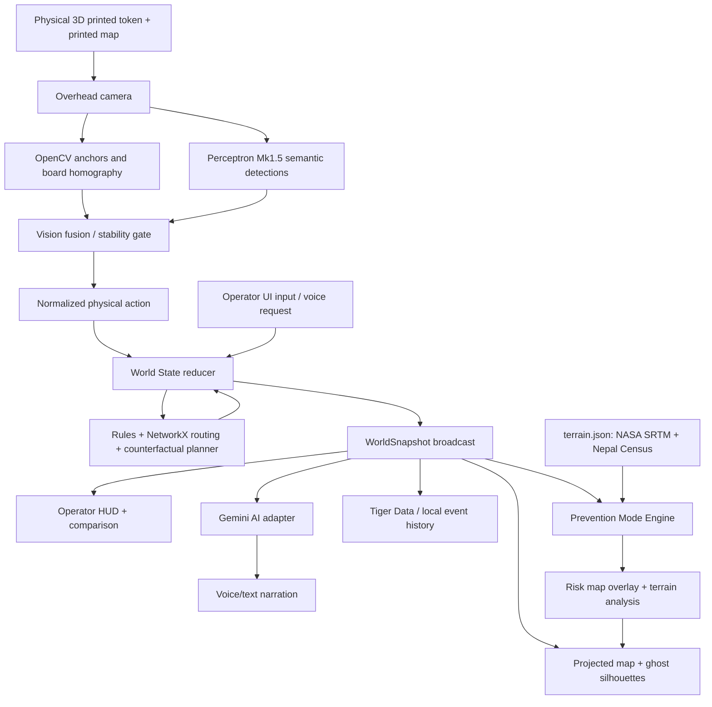

# FLOODSHIFT — MASTER BUILD SPECIFICATION

> **DubHacks 2026 · October 17–18, 2026 · four-person team · living source of truth**  
> **Version:** 2.0 / four-owner, hardware-independent implementation blueprint  
> **Primary track:** Community Kitchen  
> **Sponsor focus:** Perceptron AI (verify exact sponsored-challenge eligibility/criteria with organizers)  
> **MLH opportunities:** Best Use of Gemini API; Best Use of Tiger Data (only if the integration really ships)  
> **Development posture:** All 4 owners begin against fixtures immediately; physical equipment arrives later; complete one real Perceptron-driven interaction before optional APIs.  
> **Status convention throughout:** **P0 = demo-critical** · **P1 = worthwhile after P0** · **P2 = stretch**.
> **Core physical pieces (six):** hospital, emergency shelter, food distribution shelter, temporary bridge, disaster-start activator, and person/household marker. **Truck and helicopter remain optional legacy pieces**, not requirements for the physical set.

---

# 00. READ THIS FIRST — DECISIONS WE ARE LOCKING

## Product in one sentence

**FLOODSHIFT turns printed real-world maps into tangible, AI-assisted disaster-response simulations: players move 3D-printed resources, computer vision identifies what they placed, a causal world model calculates the consequences, and a projector overlays the outcomes and suggested interventions directly on the map.**

## The 20-second explanation to a judge

"This is a real-world map, not a screen. The camera understands these 3D-printed rescue objects through Perceptron. When you place a person marker, hospital, food station, shelter, or bridge, our simulator recalculates who can reach care and supplies. It projects the new routes and AI-recommended physical placements onto the map. You can rewind, try a different strategy, and compare the outcomes."

## What makes the project interesting

It is **not** the projector alone, the flood animation alone, or talking to Gemini. The signature invention is the **closed loop**:

1. **Observe:** detect a player's real 3D-printed piece on the board.
2. **Interpret:** use **Perceptron Mk1.5** to identify the piece's *meaning* (truck, bridge, shelter, helicopter), grounded in the overhead camera image.
3. **Locate:** use computer-vision geometry to locate the physical item consistently in board coordinates.
4. **Simulate:** change an auditable model of roads, rivers, damaged bridges, people served, and limited resources.
5. **Guide:** project **ghost intervention outlines** showing physically where an allowed improvement can be made.
6. **Verify:** observe the user's actual placement, validate it against permitted regions, and apply it to the simulation.
7. **Compare:** rewind a scenario and test a different strategy, then show an understandable difference.
8. **Explain:** Gemini answers questions using the **simulator's actual state**; it must never invent route availability or historical facts.

**Big demo moment:** A glowing ghost bridge appears at a real crossing. The judge places a 3D-printed bridge on the projected silhouette; Perceptron recognizes it; the camera localizes it; the formerly broken route lights up green; the simulated settlement becomes reachable; the AI explains why.

## Historical anchor and responsible claims

The flagship scenario is **the 26–27 August 2026 flood/mudflow/rockflow impacts in Rasuwa and Nuwakot, Nepal**, following a destructive mountain hazard event. UNOSAT published a *preliminary* satellite impact assessment on August 28, 2026. Within its assessed area of approximately 350 km², around 37 km² appeared affected, approximately 120 km of roads were potentially affected, and around 5,000 buildings were exposed or near affected locations. Those are **regional assessment figures**; do **not** present them as local board metrics. Source: [UNOSAT product 4259](https://unosat.org/products/4259/).

**Strict distinction:**

- **Historical observation:** where the real river, roads, and communities are; satellite-derived mapped impacts; documented event dates and sources.
- **Educational model:** toy or simplified local flood/hazard cells, blocked infrastructure, route travel times, resource capacities, and alternative recovery decisions.
- **Counterfactual:** "If you placed this temporary crossing, our **model** would reconnect these nodes." Do **not** say that an intervention would definitely have worked in the real event.
- **Not an emergency tool:** do not describe routes as safe evacuation instructions, or claim hydrological/structural engineering validation.

## Prevention-mode data (terrain.json, per scenario bundle)

On the real map (`nepal_rasuwa_hot_v1`, also used by `_reasoning_v1`), `terrain.json` is built by `scripts/geodata/build_risk_data.py` from measured open data. Clipped rasters and SHA-256 hashes are committed:

| Data Type | Source | Use |
|-----------|--------|-----|
| Elevation, slope, height above river | Copernicus DEM GLO-30 (AWS open data) | Zone nodes at ~1,447–1,497 m |
| Modeled residents | WorldPop 2020 constrained, 100 m (CC BY 4.0) | ~1,250 within 400 m of three settlement zones (modeled estimate, not a census) |
| Flood footprint | Copernicus GloFAS v2.1.2 RP10/RP100 depth (~90 m) | Most wet pixels are quality-flagged |
| Rivers | OpenStreetMap waterways (ODbL) | Distance to nearest mapped river |

**Risk index:** an *educational exposure index* with authored weights (0.5 modeled flood footprint, 0.3 height above river, 0.2 river proximity). It is not a flood probability. Evacuation-time, mortality and casualty figures in prevention outputs are authored teaching assumptions; no FEMA/WHO/Nepal DRR method is claimed. The schematic bundle's `terrain.json` holds illustrative values for fictional nodes.

Gemini never computes these numbers; `backend/ai/gemini_adapter.py` (google-genai SDK) only explains supplied facts, with a TEXT fallback.

## Decisions that are deliberately NOT finalized

- Exact shape/scale of **3D-printed figurines**: final printer, nozzle, print material, piece color, size, and marker attachment method are TBD. The suggested dimensions later are starting targets, not settled designs.
- Projector model, distance and mounting; camera model, field of view and mounting; projection surface size: validate on-site.
- Perceptron sponsor's exact challenge-specific conditions: the original Notion Hacker Guide was inaccessible to the available public reader at drafting time. Verify at the sponsor booth/organizer. Don't invent track-specific eligibility.
- Whether physical time-dial, Seattle second-map, Tiger Data and live voice all ship: **only after the core works**.

## Hard competition constraints

According to [DubHacks 2026 Devpost](https://dubhacks-2026.devpost.com/), teams may have **up to four members**; each selects **one** title track, **up to three** sponsored side tracks, and any number of eligible non-sponsored tracks. **Submit a Devpost draft by Saturday, October 17, before 10:30 PM PDT**, with all four team members and intended tracks. The final Devpost submission is listed as **before 10:00 AM PDT Sunday, October 18**. A separate event schedule may state 10:30 AM; obey the **earlier 10:00 AM submission deadline**.

---

# 01. THE PRODUCT / USER / SUCCESS CRITERIA

## Intended users

1. **Immediate:** DubHacks judges and visitors experiencing a three-minute collaborative simulation.
2. **Near-term:** disaster-preparedness educators, university classes, museums, community organizations and public workshops.
3. **Long-term hypothesis:** planners running *educational what-if exercises*, not actual emergency dispatch without much higher validation.

## Core user story

> As a workshop participant, I want to physically place emergency resources on a map of an actual community, see how my choices affect access to critical services, and ask why an outcome happened, so I can understand complex tradeoffs without needing GIS or logistics expertise.

## Demo definition of done (DOD)

A stranger should be able to:

1. See an accurate *physical map* aligned with digital projections.
2. Pick up a **real 3D-printed** object and place it somewhere.
3. See the software correctly label the object via a **real Perceptron API call** and locate it.
4. See a simulation state change that is **computed**, not an animation manually triggered by a team member.
5. See a glowing physical recommendation, place a matching object, and receive an explicit accepted/rejected result.
6. Compare at least **two** saved counterfactual outcomes (even if the time dial is only a button).
7. Hear or read a short AI explanation grounded in the current model.
8. Read a tiny, truthful "Historical layers / hypothetical intervention" disclaimer.

**P0 success threshold:** hospital, shelter, food station, person and bridge each have a tested observable action (physical or digital fixture); the disaster-start token triggers the scenario without duplicate starts; semantic recognition of bridge plus at least two other piece classes works on stable clean frames; all critical tokens reliably localized; calibration remains visibly aligned; bridge placement really changes graph connectivity; projector and dashboard agree; a recorded backup exists.

## Non-goals for the hackathon

- No training a custom foundation model.
- No full computational-fluid-dynamics solver or unsupported centimeter-accurate flood predictions.
- No universal recognition of arbitrary printed maps; prepare one verified Nepal map.
- No live disaster alerts, dispatching, or clinical/public safety recommendations.
- No photorealistic 3D world, animated humans, autonomous multi-agent villagers or cloud infrastructure for its own sake.
- No complex 3D computer-vision reconstruction from the printed terrain figurines.

---

# 02. FEATURE INVENTORY — WHAT EACH DOES, HOW IT WORKS, WHY IT MATTERS

## The six physical pieces are product features, not decoration

**P0 vs P1 distinction:** Physically manufacture all six if the printers allow. The **working P0 scenario** must use the *disaster-start*, *person*, *hospital*, *food shelter*, *evacuation shelter*, and *bridge* in a simple, repeatable demo. For complicated physics or AI features, a single small action per piece is enough. `truck`, `helicopter`, and the rotating time dial remain P1/P2 optional pieces from v1; nothing in the build should depend on printing them.

| Physical piece (required physical design) | P0 user action and meaning | Deterministic engine consequence | Projected and UI feedback | Why it's compelling |
|---|---|---|---|---|
| **Disaster START piece** (`disaster_start`) | Judge places a recognizable flood-warning / storm icon on a dedicated **START pad**, not arbitrarily on a real village | Transitions `ready → disaster_active` once; loads documented historical disruption baseline and starts the simulation clock; removing it does not rewrite history | Pulse along river, hazard overlay, audible scenario intro, phase banner | A physical object starts the whole story; avoids fictional claim that a human started Nepal's disaster |
| **Person piece** (`person`) | Place a person/household token on one of several numbered demand nodes | Adds *illustrative* people needing care, food, and safe shelter at that node; triggers needs-based routing and priority scoring | Small needs/risk badge; routes to services; unmet-needs panel | Makes the abstract map human-centered, and connects every other token's utility to a concrete need |
| **Hospital** (`hospital`) | Place a field-medical-service token at an approved site; alternatively use the token to select an existing mapped medical site with known provenance | Creates or activates a **hypothetical mobile field-care destination** (capacity specified in scenario fixture), then checks who can reach it | Projected medical cross, reachable/unreachable people lines, treatment capacity status | Shows that "a road exists" does not automatically mean care is accessible |
| **Shelter** (`shelter`) | Place temporary accommodation at one of 2–3 eligible sites | Supplies limited **overnight/refuge capacity**, checks site hazard and access, assigns displaced demand | Tent icon, green/amber/red location feedback, housing demand covered | Introduces an explicit tradeoff between safety, capacity and access |
| **Food shelter** (`food_shelter`) | Place a **food/water distribution station** (not residential shelter) at a valid supply-access site | Supplies limited food parcels/units per simulated turn to reachable person nodes; requires a route from depot | Food icon, dotted distribution routes, remaining need, over-capacity alert | Adds the critical dependency: reaching shelter is different from receiving food and water |
| **Bridge** (`bridge`) | Move printed bridge into a projected ghost crossing | If eligible and affordable, toggles a predefined synthetic/representative road-graph connection; reruns medical/food/shelter reachability | Ghost outline → verified alignment → crossing turns green; response graph updates | Core closed-loop interaction: AI suggests a *physical* intervention; computer vision verifies it; world changes |

**Important semantic distinction:** `shelter` = temporary refuge/overnight accommodation; `food_shelter` = **food and water distribution center**. Never conflate them in prompts, visual labels, or output metrics. `hospital` is the proposed *field medical station* unless a specific existing mapped hospital location is verified; placing a toy hospital does not assert a real hospital existed at that geographic point. `person` is an **aggregated scenario household/need marker**, not an identified Nepal victim. The START piece is a **game control**, not a physical cause of the historical disaster.

## Other retained features (all v1 mechanisms preserved)

| Feature | Priority | Implementation | Judge payoff | No-hardware fallback |
|---|---|---|---|---|
| **Nepal 2026 real-data basemap** | P0 | Offline preprocess HOT/HDX corridor roads, bridges, waterways, settlements, service sites + provenance | Geography grounded in humanitarian mapping | Prepared GeoJSON-to-SVG + small attributed graph |
| **Perceptron semantic piece recognition** | **P0, sponsor centerpiece** | Stable camera frame → Perceptron detects **physical visual class** → bbox; OpenCV fiducial assigns accurate identity/pose | Genuine physical AI interpreting printed miniatures | Recorded **real Perceptron outputs** used in replay, clearly marked replay |
| **OpenCV tracking / calibration** | P0 | Board corners and instance-only fiducials; camera→board mapping; projector manual warp or homography | Immediate response to object movement | Mouse and JSON controls producing identical action schema |
| **Projected map + symbol effects** | P0 | SVG/Canvas overlay registered to paper; flood/disruption highlights, routes, ghost interventions | Tables become explorable worlds | Same full-screen overlay on monitor |
| **Road/resource/need simulation** | P0 | NetworkX graph + site checks + finite capacities; **no fake high-resolution flood solver** | Computed causal changes affect multiple types of human need | Unit-tested demo graph |
| **Ghost planner** | **P0** | Score legal crossing placements by increase in *needs served*, not just distance saved | Proposed change appears physically on the board | On-screen ghost overlay |
| **Rewind / branch comparison** | P1 | Immutable snapshots; compare two route/service outcomes; physical dial optional | "What if we try something else?" | Compare buttons and local JSON |
| **Gemini incident coordinator** | P1 | Read-only tool-backed questions about people/care/food/shelter/bridge alternatives | Reactive storytelling, no fabricated data | Text narrations from state-derived templates |
| **Disaster Prevention Mode** | **P0** | Same tokens with prevention semantics; risk map overlay; real terrain data (NASA SRTM + Nepal Census); FEMA/WHO/Nepal DRR formulas | Plan evacuations BEFORE disaster; compare outcomes | Formula-based calculations without Gemini |
| **Perceptron semantic scene audit** | P1 | Verify what pieces are visible before/after an intervention; detect wrong object type | Strong sponsor evidence beyond simple detection | Single-frame detection test |
| **Tiger Data time-series** | P2 | Persist branch events and metrics, compare outcomes | Real analytics sponsor story | Local event log JSON or SQLite |
| **Seattle MapSwap** | P2 | Additional independently preprocessed city bundle with scenario QR/ID | Shows platform potential | Video/storyboard only |
| **Legacy truck and helicopter pieces** | P1/P2 | Resource deployment, road route / limited aerial alternative | Extra story branches | Use digital icons without waiting on print |

**P0 demo mechanic:** START → place person → place hospital/food/shelter → observe blocked access → AI-generated *ghost bridge* → place bridge → unmet food/medical/refuge need decreases. For strongest clarity, person and service tokens should already be staged when the three-minute presentation begins; physically move 2–3 of them live. All service capacities, need counts and costs are **toy scenario parameters**, never observed casualty figures.

**Mode badges:** `VISION=LIVE_PERCEPTRON|REPLAY|MANUAL`, `PROJECTOR=CALIBRATED|SCREEN`, `GEMINI=LIVE|TEXT|OFF`, `DATA=HOT_DERIVED|SCHEMATIC`, `MODE=RELIEF|PREVENTION`; a fallback must never masquerade as live model execution.

---

# 03. TEAM OWNERSHIP — FOUR INDEPENDENT LANES, EASY MERGES

**Locked assignment requested by team:** Person 1 leaves early/temporarily to secure hardware, use the MILL printers, collect camera/projector, and print maps. Person 1 gets **light software** and physical QA. **Persons 2, 3, 4 each own a code-intensive, fully testable software module** before any physical hardware arrives. No person should need another person's unmerged code to prove that their module works.

| Owner | Ownership in one phrase | Code intensity | Files they edit exclusively | First independent proof before hardware |
|---|---|---|---|---|
| **Person 1 — Maker, Source Pack, Demo QA** | Buy/borrow hardware, 3D print **six pieces**, print map; maintain approved assets, source notes and action fixtures | Light (10–15%) | `hardware/**`, `assets/**`, `docs/DEMO_SCRIPT.md`, `docs/ATTRIBUTION.md`, `scenarios/**/visual_assets/`, `tests/fixtures/physical_token_manifest.json` | Six token definitions + placeholders/photos + legible printed map PDF or SVG; mocked token event list runs through the demo |
| **Person 2 — UI/UX & Projection** | Design and implement the **operator screen and projector display**, transitions, ghost overlays, status panels, demo interactions; optionally front-end Gemini voice controls | Intensive (30%) | `frontend/**` (except generated API types), `assets/animations/**` | `npm run dev` renders full three-minute playthrough from `WorldSnapshot` fixture, keyboard/mouse fallback and scripted mock WebSocket |
| **Person 3 — Physical AI & Integration API** | **Perceptron** semantic detection (core), **markerless object tracking** (no QR codes!), camera/projector calibration, observation fusion, API/WebSocket gateway, action dispatch, **Gemini AI integration**, **disaster prevention mode** | Intensive (30%) | `backend/perception/**`, `backend/calibration/**`, `backend/main.py`, `backend/contracts.py`, `backend/api/**`, `backend/ai/**`, `backend/planning/prevention.py` | Recorded/static image → model bbox/class + OpenCV CSRT tracking → validated `ObjectObservation`; mock POST action broadcasts a snapshot; prevention endpoints return risk analysis |
| **Person 4 — Nepal Data, World Simulation & Planner** | HOT/HDX import, road graph, people/food/medical/shelter mechanics, event reducer, ghost-site search, branch comparison, Gemini read-only tool functions | Intensive (30%) | `scripts/geodata/**`, `backend/world/**`, `backend/simulation/**`, `backend/planning/**`, `backend/narration/**`, `scenarios/**/data/**`, `tests/test_world_*.py` | `pytest` confirms start event, six token mechanics, invalid placement, route reconnection and consistent metrics without camera/frontend |

### Extra work delegation that doesn't create a bottleneck

- **P1**: assemble `token_catalog.json` (labels, symbolic colors, site restrictions), make six simple STL/model folders or license-cleared replacements, export the **print-ready aligned map**, create fixture `demo_actions.json`, attribution/Devpost, record test photos. **No critical production backend code**.
- **P2**: CSS/SVG/React; coordinate-aware projector overlay; dual-screen UI; operator controls; fake-socket test harness; optionally browser `speechSynthesis`, push-to-talk and Gemini frontend; never own road physics.
- **P3**: **markerless object tracking** (OpenCV CSRT), Perceptron semantic detection, camera controls, projector calibration utility, FastAPI routes and sockets, map ID / START token gating, vision fusion, **Gemini AI adapter** (`backend/ai/`), **prevention mode endpoints** (`/prevention/*`), real terrain data integration; never own final UX styling or modify world physics. **No QR codes needed on tokens!**
- **P4**: all actual scenario transitions and rules, fixed historical scene bundle, eligible placement planner, metrics, snapshots; optional Gemini connector and Tiger writer **after** essential reducer passes.

### The exact dependency boundary (freeze within 20 minutes)

1. P4 publishes `contracts/fixture_world.json` and a `WorldService` with `snapshot()`, `apply(action)`, `suggest(goal)`, `compare(branches)`; P2 consumes snapshots, P3 consumes actions.
2. P3 owns the route `POST /action`, `GET /world`, `GET /scenario`, `POST /plan/suggest`, `GET /health`, `WS /ws` and serializes using common Pydantic schemas. If P4's code is absent, run **MockWorldService** with exactly the same interface.
3. P2 renders **only** snapshots and user input events; never recomputes medical/food/road decisions in React. If API is absent, use `frontend/src/mocks/world.json` and a locally mocked socket.
4. P3's camera emits `ObjectObservation`. The observation-to-action adapter consults P1's `token_catalog.json` and P4's approved site catalog. No class detection alone triggers a significant mutation.
5. P1 prints the **same generated `map_print.svg`** that P2 projects overlays against. P1 may edit token metadata and images but **does not edit** `backend/main.py`, `WorldService`, or React state.
6. Only **P4's reducer** mutates authoritative world state. Gemini and Perceptron do not make irreversible decisions; P3 enforces action validation at ingress.

### Mandatory module tests and person-owned demos

| Person | Run this locally without hardware | What qualifies as done |
|---|---|---|
| 1 | `python scripts/demo_fixture_validator.py tests/fixtures/demo_actions.json` | Catalog references all 6 token types; map exports correct aspect/anchor labels; screenshot and print instructions committed |
| 2 | `cd frontend && npm run dev` with `VITE_USE_MOCKS=true` | The same fixture triggers map, red/green routes, needs bars, ghost placements and narration card; nothing depends on projector |
| 3 | `pytest tests/test_observations.py tests/test_calibration.py tests/test_api.py tests/test_prevention.py` plus saved frames | Stable instance IDs and type/pose fusion; real Perceptron call recorded separately when credentials arrive; API smoke passes with mock world; prevention endpoints return valid risk analysis |
| 4 | `pytest tests/test_world_start.py tests/test_world_resources.py tests/test_world_planner.py` | Every scenario rule verified, no negative inventory, duplicated activator ignored, replay deterministic |

### Merge choreography — designed to be easy

- **At T+0:20:** commit this MD, Python `backend/contracts.py`, TypeScript `frontend/src/types/contracts.ts`, one snapshot and action fixtures, `token_catalog.json`. If any changes to these are needed, appoint P3 schema integrator and notify all.
- **At T+1:30:** P2 can demo mock UI; P3 can demo Perceptron against photographed cardboard proxies; P4 can run unit tests. P1 can be at the MILL without blocking anyone.
- **At T+3:00:** merge P4 world into P3 API, then P2 points UI at API. Run digital demo before connecting camera.
- **After hardware arrives:** P3 substitutes `LiveCameraAdapter` for `FixtureObservationAdapter`; P2 turns projector on; P1 mounts camera, tests pieces, and records proof; P4 watches state transitions and fixes model rules.
- **Final several hours:** stop adding features, switch to repeated physical tests, bug fixes and demo rehearsal. P1 owns physical reset; P2 owns visual reset; P3 owns camera reset; P4 owns world reset.

### Ownership limits prevent 'one person has to fix everything'

Person 2 controls display; Person 3 controls capture/API; Person 4 controls simulation. **All persons can reset and test their own module with mocks.** Never put owner-specific assumptions into shared file paths or require the same laptop for development. Tests use fixture photos/synthetic ArUco images/JSON until hardware arrives. `uv` is unitless board UV, `(0,0)` is top-left on *all* screens. P1 tells the team exact paper dimensions before full projection calibration.

### One universal communication rule

Every 90 minutes post **WORKING / BROKEN / TEST COMMAND / NEXT HANDOFF**, with a 5–10 second capture proving that the feature works. Change shared schemas by small agreed commits; do not hold unmerged changes until midnight.

---

# 04. RECOMMENDED REPOSITORY AND TECHNOLOGY STACK

## Monorepo layout (create immediately)

```text
floodshift/
├── README.md                    # short Devpost-friendly setup, link to THIS spec
├── docs/
│   ├── ATTRIBUTION.md
│   ├── HARDWARE_CHECKLIST.md
│   ├── MASTER.md                # source of truth: THIS DOCUMENT
│   ├── DEMO_SCRIPT.md
│   ├── ASSUMPTIONS.md
│   └── SPONSOR_EVIDENCE.md
├── .env.example
├── .gitignore
├── pyproject.toml               # Python dependencies
├── frontend/
│   ├── package.json
│   ├── index.html
│   └── src/
│       ├── App.tsx
│       ├── components/{ProjectionView,OperatorPanel,StateBadge}.tsx
│       ├── hooks/useWorldSocket.ts
│       ├── components/MapProjection.tsx
│       ├── styles.css
│       └── types/contracts.ts
├── contracts/
│   ├── fixture_world.json         # cross-team freeze fixture
│   └── token_catalog.json
├── backend/
│   ├── api/{mock_world.py,events.py}
│   ├── main.py                  # FastAPI server + single world store
│   ├── contracts.py             # Pydantic authoritative schemas
│   ├── settings.py
│   ├── ai/                      # AI integration module (P3)
│   │   ├── __init__.py
│   │   └── gemini_adapter.py    # Gemini AI with fallback formulas
│   ├── perception/
│   │   ├── camera.py
│   │   ├── markers.py
│   │   ├── perceptron_adapter.py
│   │   ├── fusion.py
│   │   └── state_gate.py
│   ├── calibration/
│   │   ├── board.py
│   │   └── projector.py
│   ├── world/
│   │   ├── state.py
│   │   ├── rules.py
│   │   └── scenarios.py
│   ├── simulation/
│   │   ├── routing.py
│   │   ├── reachability.py
│   │   └── hazards.py
│   ├── planning/
│   │   ├── ghost_bridge.py
│   │   ├── prevention.py        # Prevention mode with FEMA/WHO/Nepal DRR formulas
│   │   └── compare.py
│   ├── narration/
│   │   └── narration_fallback.py
│   └── persistence/
│       ├── local_json.py
│       └── tiger_optional.py
├── scenarios/
│   ├── nepal_rasuwa_v1/
│   │   ├── manifest.json
│   │   ├── data/
│   │   │   ├── roads.json, points.json, hazard.json, sites.json
│   │   │   ├── terrain.json       # Real terrain: NASA SRTM elevation + Nepal Census population
│   │   │   └── source_manifest.json
│   │   └── visual_assets/{map_print.svg,map_projection.svg,legend.svg}
│   └── seattle_southpark_v1/     # P2: do not start until Nepal is fully proven
├── hardware/
│   ├── tokens/{hospital,shelter,food_shelter,bridge,disaster_start,person}/
│   ├── tokens_optional/{truck,helicopter,time_dial}/
│   ├── markers/
│   ├── print-settings.md
│   └── camera-projector-setup.md
├── assets/
│   ├── icons/
│   ├── recordings/
│   ├── screenshots/
│   └── attribution.md
├── tests/
│   ├── fixtures/{demo_actions.json,physical_token_manifest.json,board_frames/}
│   ├── test_world_start.py
│   ├── test_world_resources.py
│   ├── test_observations.py
│   ├── test_calibration.py
│   ├── test_api.py
│   ├── test_prevention.py          # Prevention mode endpoint tests (P3)
│   ├── test_tracker.py             # Markerless tracking tests (P3)
│   ├── test_routing.py
│   ├── test_bridge_rules.py
│   ├── test_planner.py
│   ├── test_scenario_schema.py
│   └── fixtures/
└── scripts/
    ├── preprocess_osm.py
    ├── draw_marker_sheet.py
    └── demo_smoketest.py
```

## Technologies: use mature libraries, don't rebuild them

| Problem | Use | Why | GitHub/docs | Alternative / note |
|---|---|---|---|---|
| Camera / fiducials / homography | **opencv-contrib-python** + NumPy | ArUco, perspective transforms, image processing | [OpenCV](https://github.com/opencv/opencv) | Verify `cv2.aruco` available; avoid mixing `opencv-python` with contrib wheel |
| Visual semantic recognition | **Official Perceptron Python SDK**, model/account capability verified at runtime | Sponsor-first spatial model, box-grounded scene parsing | [official SDK](https://github.com/perceptron-ai-inc/perceptron) | Live API key required; cache snapshots as fallback |
| Core server + events | **FastAPI**, Uvicorn, Pydantic | Typed Python services, WebSockets, Swagger | [FastAPI](https://github.com/fastapi/fastapi) | No complicated microservices |
| Graph/shortest path | **NetworkX** | Already implements shortest paths/connectivity | [NetworkX](https://github.com/networkx/networkx) | For tiny graph, speed is a nonissue |
| Geometry | **Shapely**, **pyproj** | Site polygons, nearest eligible point, CRS | [Shapely](https://github.com/shapely/shapely), [PROJ](https://github.com/OSGeo/PROJ) | Board is normalized 2D; only preprocess geo projections once |
| OpenStreetMap roads | **OSMnx** / GeoPandas | Import/simplify OSM road graph before event | [OSMnx](https://github.com/gboeing/osmnx), [GeoPandas](https://github.com/geopandas/geopandas) | If no reliable network, handcraft a small attributed graph and disclose it |
| Satellite raster / elevation | **Rasterio** + NumPy (preprocessing ONLY) | Crop and rasterize maps into grid cells | [Rasterio](https://github.com/rasterio/rasterio) | No live raster service dependency |
| UI/operator | **React + Vite + TypeScript** | Fast UI development and hot reload | [React](https://github.com/facebook/react), [Vite](https://github.com/vitejs/vite) | Plain SVG over printed map is sufficient |
| Projection overlays | **SVG / Canvas 2D**, optional **Konva** | Crisp lines, ghost silhouettes, pulse highlights | [Konva](https://github.com/konvajs/konva) | Avoid WebGL unless needed; flat board simplifies everything |
| Map source preview | **MapLibre GL JS** (optional offline preparation) | Beautiful geo preview/editor | [MapLibre](https://github.com/maplibre/maplibre-gl-js) | Projection should show pre-rendered static geometry, not live remote tiles |
| AI spoken/text narration | **Google Gen AI SDK** | Function calling; optional Gemini Live voice | [googleapis/python-genai](https://github.com/googleapis/python-genai), [Live examples](https://github.com/google-gemini/gemini-live-api-examples) | Start with text, optional browser speech synthesis for reliable audio |
| Time-series and replay | **Tiger Data / TimescaleDB** + psycopg | Store metrics; query comparisons | [TimescaleDB](https://github.com/timescale/timescaledb) | Optional; local JSON is enough for P0 |
| 3D-printed pieces | **CadQuery** or **OpenSCAD** | Parametric token bases and STL export | [CadQuery](https://github.com/CadQuery/cadquery), [OpenSCAD](https://github.com/openscad/openscad) | Use existing permissively licensed models for decorative top pieces; adapt bases |
| Testing | **pytest**, ruff; frontend typecheck | Rapid tests for deterministic behavior | [pytest](https://github.com/pytest-dev/pytest) | Avoid waiting until end to test |

**Dependency discipline:** choose Python 3.11 or 3.12 across the team and pin working packages. **Perceptron SDK examples have changed:** the public README currently contains `detect("file.jpg", classes=[...])` with structured detections in `result.points` and DSL `image(path)` examples; other versions expose `result.boxes`. P3 must run a **real credentials-on smoke test**, inspect the installed API and normalize either response in one adapter. Do not assume a single API shape based on a blog post.

## Install baseline

```bash
# Python (one person checks versions, then everyone copies)
python -m venv .venv
# macOS/Linux: source .venv/bin/activate
# Windows PowerShell: .venv\Scripts\Activate.ps1
python -m pip install --upgrade pip
pip install perceptron opencv-contrib-python numpy \
  fastapi 'uvicorn[standard]' pydantic networkx shapely \
  httpx python-dotenv pytest pillow
# Only if using real geospatial preprocessor:
pip install geopandas osmnx pyproj rasterio
# Optional only after P0:
pip install google-genai psycopg[binary]

# JS / frontend
cd frontend
npm install
npm install react react-dom
npm install -D vite typescript @types/react @types/react-dom
# if desired: npm install konva react-konva
```

For Windows native native geospatial packages, prefer a known working conda environment or pre-generated JSON bundles; don't burn hackathon hours resolving GDAL compilation.

## `.env.example`

```dotenv
PERCEPTRON_API_KEY=
PERCEPTRON_MODEL=perceptron-mk1.5
GEMINI_API_KEY=
DATABASE_URL=
CAMERA_INDEX=0
CAMERA_WIDTH=1280
CAMERA_HEIGHT=720
SCENARIO_ID=nepal_rasuwa_v1
PERCEPTRON_MODE=live
GEMINI_MODE=text
GEMINI_MODEL=gemini-1.5-flash
MAP_PROJECTION_MODE=screen
ENABLE_TIGER=false
ENABLE_PREVENTION=true
LOG_LEVEL=INFO
```

Never commit `.env`, raw credentials, user speech recordings, or third-party proprietary map data.

---

# 05. SYSTEM DESIGN — ONE AUTHORITATIVE WORLD STATE



## Execution path (the happy path)

1. Camera captures a new view; identifies map corners (fixed IDs). `H_camera_to_board` maps pixels into `(u,v)` normalized board values between 0 and 1.
2. Local CV locates **tokens** using fiducials on their bases, but marker ID **does not encode a token class**. This is important for Perceptron: the vision model must identify the physical object's semantic type.
3. After the token stops for e.g. 600–900 ms, send a cropped/rectified **real camera frame** to Perceptron. Classify visible printed objects and return bounding boxes + labels.
4. Match semantic bounding boxes to anchors (centers + proximity); produce `ObjectObservation` with type, stable instance ID, normalized board point, confidence status, timestamp, and image provenance.
5. State gate checks that the class is allowed and placement is stable; if not, projector shows an *amber unconfirmed outline* rather than applying an action.
6. The world reducer validates token action against the scenario: e.g. `bridge` must be at a predefined physical crossing anchor, cannot exceed resources, cannot overwrite a deployed bridge, and does not 'repair' any real-world bridge.
7. Graph connectivity updates; compare old/new `reachable_facilities`, `blocked_edges`, `shortest_supply_cost` metrics.
8. Planner (when asked) simulates candidate changes on **clones** of the state, returns an eligible ghost placement and predicted delta. It never mutates live state until a human physically approves it.
9. Projector draws roads, river, hazard, route and ghost bridge. Operator dashboard shows diagnostics separately.
10. Gemini is told **only** structured current state and tool results; it explains simulated consequences and refuses to claim historical validation.
11. Event log stores input, prior state version, accepted/rejected action, world version, simulator results, latency and mode flags.

## Avoid the fatal architecture mistakes

- **Do NOT** have React, Gemini, and Perceptron each maintain independent world states.
- **Do NOT** run the Perceptron network request every camera frame. Stable scene trigger only.
- **Do NOT** let hallucinated labels or descriptions automatically change bridges/roads.
- **Do NOT** use screen pixels directly as geographic coordinates.
- **Do NOT** project white bright patterns over fiducials when tracking them; mask marker squares in the output.
- **Do NOT** make projector alignment depend on changing camera position after calibration.

---

# 06. FROZEN SHARED CONTRACTS — SIX PIECES, TESTABLE WITHOUT HARDWARE

## Coordinate systems

- `camera_px`: image pixels, upper-left origin.
- `board_uv`: normalized `[u,v]`, `(0,0)` printed-map upper left and `(1,1)` bottom right.
- `projector_px`: calibrated projector pixels, separate from camera.
- `geo_lonlat`: WGS84 degrees **only during offline processing**. Convert to a projected CRS for metric routing; never use Euclidean distance in lon/lat degrees.
- Every scenario entry and SVG layer uses the **same board UV transformation** from source GIS bounds. Camera and projector independently register to that UV space.

## Stable type vocabulary (six required plus optional legacy)

`TokenType = "hospital" | "shelter" | "food_shelter" | "bridge" | "disaster_start" | "person" | "truck" | "helicopter" | "time_dial"`.

**Never use `food_shelter` as a synonym for `shelter`.** Labels for the UI are `Hospital / Field Care`, `Emergency Shelter`, `Food & Water`, `Temporary Bridge`, `Start Disaster`, `People / Household`. The final printed pieces should display a symbol *and* a short text label so Perceptron and humans can differentiate them.

### Example `contracts/token_catalog.json` — P1 owns visual definitions, P3 validates semantics

```json
{
  "catalog_version": 2,
  "tokens": {
    "hospital": {"display_name":"Hospital / Field Care", "icon":"medical-cross", "perceptron_hint":"miniature building with medical cross", "valid_site_kinds":["medical_site"], "effect":"activate_field_care"},
    "shelter": {"display_name":"Emergency Shelter", "icon":"tent", "perceptron_hint":"miniature sleeping refuge tent", "valid_site_kinds":["shelter_site"], "effect":"deploy_shelter"},
    "food_shelter": {"display_name":"Food & Water Station", "icon":"bowl", "perceptron_hint":"miniature aid distribution canopy with food symbol", "valid_site_kinds":["food_site"], "effect":"deploy_food_station"},
    "bridge": {"display_name":"Temporary Bridge", "icon":"bridge", "perceptron_hint":"miniature bridge span across river", "valid_site_kinds":["bridge_crossing"], "effect":"deploy_bridge"},
    "disaster_start": {"display_name":"START DISASTER", "icon":"storm", "perceptron_hint":"miniature orange storm warning button or token", "valid_site_kinds":["control_start_pad"], "effect":"start_disaster"},
    "person": {"display_name":"People / Household", "icon":"person", "perceptron_hint":"miniature human figurine with circular base", "valid_site_kinds":["population_node"], "effect":"place_people"}
  }
}
```

Hints and icons are **design inputs**, not promised Perceptron predictions. The human team must print visually distinguishable silhouettes and test them. ArUco marker ID encodes **instance identity only**, never `hospital/bridge` semantics. Perceptron classifies the actual printed geometry.

### `scenarios/nepal_rasuwa_v1/manifest.json` (illustrative; source fields must be audited)

```json
{
  "scenario_id":"nepal_rasuwa_v1",
  "name":"Nepal 2026 — Bhote Koshi / Trishuli educational exercise",
  "historical_event_date":"2026-08-26",
  "scenario_label":"HOT/HDX geospatial context + hypothetical interventions",
  "board":{"width_mm":420,"height_mm":297,"uv_origin":"top_left"},
  "allowed_types":["hospital","shelter","food_shelter","bridge","disaster_start","person","truck","helicopter"],
  "data_sources":[
    {"id":"hot_activation","url":"https://website.hotosm.org/en/projects/nepal-flood-2026/","role":"activation/context"},
    {"id":"affected_area_overview","url":"https://production-raw-data-api.s3.amazonaws.com/ISO3/NPL/overview/hot_flood_npl_overview.html","role":"affected-area overview / layer inventory"},
    {"id":"corridor_dataset","url":"https://data.humdata.org/dataset/hot_flood_npl_corridor","role":"downloadable corridor source; inspect each resource and license"}
  ],
  "historical_layer":"observed-or-mapped-context",
  "simulation_layer":"counterfactual-educational",
  "scenario_version":2
}
```

A3 paper size, selected map bounds and intervention capacities are provisional. Never label a hypothetical field hospital as a confirmed real 2026 facility. P4 maps actual source fields to explicit provenance in `source_manifest.json`.

### WorldSnapshot fixture — **single authority produced by Person 4**

```json
{
  "schema_version": 2,
  "world_version": 12,
  "scenario_id":"nepal_rasuwa_v1",
  "phase":"disaster_active",
  "simulation_stage":2,
  "branch_id":"main",
  "token_inventory":{"hospital":1,"shelter":1,"food_shelter":1,"bridge":1,"person":2},
  "tokens":[
    {"id":"token-bridge-01","type":"bridge","board_uv":[0.47,0.61],"site_id":"crossing_east","vision_source":"perceptron","status":"accepted"},
    {"id":"token-person-01","type":"person","board_uv":[0.72,0.42],"site_id":"people_east","vision_source":"perceptron","status":"accepted"}
  ],
  "facilities":[
    {"id":"field_hospital_1","type":"hospital","capacity_model":12,"used_capacity_model":5,"reachable":true},
    {"id":"food_station_1","type":"food_shelter","capacity_model":20,"used_capacity_model":12,"reachable":true},
    {"id":"overnight_shelter_1","type":"shelter","capacity_model":15,"used_capacity_model":8,"reachable":true}
  ],
  "population_demand":[{"id":"people_east","households_model":1,"people_model":8,"need_food":8,"need_medical":2,"need_refuge":8}],
  "edges":[{"id":"crossing_east_road","blocked":false,"reason":"counterfactual_temporary_bridge"}],
  "metrics":{"people_reachable_for_medical":8,"people_reachable_for_food":8,"people_reachable_for_shelter":8,"unmet_food_model":0,"unmet_medical_model":0,"unmet_refuge_model":0,"blocked_roads":1},
  "ghost_suggestion":{"token_type":"bridge","site_id":"crossing_east","board_uv":[0.47,0.61],"reason_code":"improves_multi_service_access"},
  "narration_event":{"event_type":"bridge_reconnected","model_only":true},
  "provenance_label":"Historical map data; intervention outcomes are illustrative"
}
```

**All sample numerical values are invented test fixture quantities**, not Nepal disaster statistics. The actual app should compute needs from fixture settings; do not hardcode success into the frontend.

### Person 3's `ObjectObservation` — semantic vision + geometric pose

```json
{
  "event_type":"object_observed",
  "event_id":"obs-1042",
  "frame_id":224,
  "token_id":"fiducial-31",
  "object_type":"food_shelter",
  "class_source":"perceptron",
  "perceptron_box_1000":[342,410,495,588],
  "board_uv":[0.472,0.61],
  "rotation_deg":3,
  "stable_ms":850,
  "vision_status":"confirmed",
  "frame_provenance":"local:fixtures/frame224.png"
}
```

`vision_status` is an **application classification**, not an invented model confidence score. Camera jitter and hands occluding objects must not create repeated placements. START piece events are **idempotent**: a placed or removed activator cannot advance flood stages repeatedly.

### WorldAction — shared P3 ingress, P4 reducer, P2 digital fallback

```json
{
  "action_id":"act-207",
  "type":"place_token",
  "source":"physical_perceptron",
  "token_id":"fiducial-31",
  "token_type":"food_shelter",
  "site_id":"food_site_west",
  "board_uv":[0.32,0.54],
  "expected_world_version":11,
  "timestamp_utc":"2026-10-17T20:02:31Z"
}
```

Use `type = "place_token" | "move_token" | "remove_token" | "advance_stage" | "reset" | "suggest" | "branch" | "compare"`; keep token subtypes in `token_type`. The adapter resolves board coordinates to permitted `site_id`s. World reducer maps subtype to internal effects (`start_disaster`, `place_people`, `activate_field_care`, `deploy_food_station`, `deploy_shelter`, `deploy_bridge`). Duplicate `action_id`s, stale `expected_world_version`, invalid site, insufficient inventory, and insufficient model budget must be rejected with explicit reasons. The frontend *renders* the rejection but never computes it independently.

### Event stream

```json
{
  "type":"world.snapshot",
  "seq":136,
  "sent_at":"2026-10-17T20:02:31Z",
  "payload":{"schema_version":2,"world_version":12,"phase":"disaster_active","tokens":[],"metrics":{}}
}
```

### Freeze ownership and handoffs

| Contract / file | Producer | Consumer | Deadline |
|---|---|---|---|
| `contracts/token_catalog.json` | Person 1 (P3 approves type names) | All | T+20 min |
| `backend/contracts.py` / shared fixture JSON | Person 3 + Person 4 agree | P2, P4 | T+20 min |
| `frontend/src/types/contracts.ts` | P2 mirrors contract | P2 | T+30 min |
| `ObjectObservation` | P3 live / mock | P4 reducer via P3 gateway | T+60 min |
| `WorldAction` | P3 gateway / P2 manual controls | P4 | T+30 min |
| `WorldSnapshot` / `WorldService` | P4 | P3 API / P2 UI / Gemini | T+45 min |
| `ScenarioManifest` + `sites.json` | P4 (P1 assets) | P3 / P2 | T+90 min |
| `MapCalibration` | P3 | P2 | T+90 min with synthetic fixture |
| `map_print.svg` + `map_projection.svg` same viewBox | P1 prints; P2 renders; P4 supplies data | All | T+2h |

**Mock-first policy:** Before real equipment, P2 runs the exact same actions against fixture JSON, P3 tests detection against provided photos/printed marker sheet, P4 tests pure reducers, P1 verifies print labels and source-attribution. **No owner waits for the MILL.**

---

# 07. PERCEPTRON AI — CORE IMPLEMENTATION (NOT A DECORATIVE API)

## Why Perceptron gets a genuine core role

If every 3D piece has a marker that encodes "bridge", "truck", etc., Perceptron becomes unnecessary. **Do not do that.** Use the marker only to derive a stable **instance/pose**. Let **Perceptron** identify the **physical object's visual class** and ground that class to a box in a real image. Then fuse the semantic class and marker pose.

**Perceptron's must-have jobs:**

1. **Recognize the 3D-printed asset category** from the actual physical appearance, e.g. toy-like bridge vs rescue truck vs shelter, returned as grounded visual bounding boxes.
2. **Register its meaning to an object track** (`fiducial-31`, etc.) via bbox-to-marker association, so moving the piece continues to mean "bridge" even when the cloud inference is idle.
3. **Re-confirm when the object changes**, e.g. a miniature shelter replaces the bridge on the same base. Cached marker-to-semantic links should expire when the object leaves/re-enters or on operator request.
4. **Optional higher-value verification:** use a second Perceptron visual question to check "is a bridge physically located at the highlighted crossing?" against the full current board image. The geometry validator remains authoritative.

This makes Perceptron essential for identifying the *things* being manipulated; OpenCV remains essential for precise repeatable *where*.

## Verified current Perceptron SDK usage

The [official Perceptron SDK](https://github.com/perceptron-ai-inc/perceptron) provides `detect`, semantic boxes, and visual Q&A. **Its README/examples differ across published revisions**: `result.points` appears in current public README examples, while other SDK versions use `.boxes`; some accept an ordinary file path while DSL examples use `image(path)`. **Do not ship until P3 smoke-tests the installed version and logs the result schema.** The adapter below normalizes either `points` or `boxes` and confines SDK-specific changes to a single file. Coordinates may be on a normalized 0–1000 scale; assert the returned range against real examples.

Minimal smoke test (requires live key):

```python
# scripts/test_perceptron.py
from pathlib import Path
from perceptron import detect

frame = Path("assets/test_frames/board_clean.jpg")
assert frame.exists(), "Capture a real board photo first"

result = detect(
    str(frame),
    classes=[
        "miniature bridge", "miniature field hospital with a red cross",
        "miniature sleeping shelter tent", "miniature food distribution canopy",
        "miniature standing person figurine", "miniature storm warning start marker"
    ],
    model="perceptron-mk1.5"
)
boxes = getattr(result, "boxes", None) or getattr(result, "points", None) or []
for box in boxes:
    print(box.mention, box.top_left, box.bottom_right)

# For a separate visual-QA feature, inspect the installed question()/perceive() signature.
# Save the real detection payload and image, not fabricated JSON.
```

**First-run objective:** one successful request identifying at least one printed physical object and showing a bbox. Save the raw output and annotated screenshot to `assets/screenshots/perceptron-proof/`. If key access fails, contact sponsor help immediately and continue with the **degraded mode**; don't block the rest of the project.

## Detailed CV-to-semantic fusion plan

**Input:** camera frame 1280×720, 4 map corner fiducials, 1–4 movable token markers; physical pieces must have sufficient visual silhouette to be recognized independent of the printed marker.

**Perceptron path:**

1. Stabilization: poll local marker positions at camera framerate. Trigger a semantic inference only when a marker first appears, moves enough to likely represent a new interaction, or its cached label expires.
2. Freeze the **cleanest recent full frame**, ideally with no judge's hand covering the token. If the projector produces colored wash that hides the objects, briefly show a neutral/dim projection frame for ~0.2–0.5 s while photographing, then restore overlays. Do not flash aggressively.
3. Option A: send the whole rectified board frame and request detections for all classes. Option B: crop each relevant object with background context (test which gives better recognition). For any crop, convert returned coordinates back into **full camera** coordinates before homography.
4. `detect(image(frame), classes=[...])` returns normalized bbox coordinates. Convert `(x/1000*frame_width, y/1000*frame_height)`.
5. If a bbox center lies near a known fiducial center (or overlaps its bounding token region), fuse label with marker ID. Prefer one-to-one matching (small Hungarian assignment with SciPy, or greedy nearest match for just 4 objects).
6. Map the marker's camera pixel center through camera->board homography, not the Perceptron center. This improves precision.
7. Require class to be recognized and physical placement to remain stable for e.g. 750 ms. Cache semantic class for that token ID until it leaves the field of view or explicitly changes.
8. Emit one `ObjectObservation` with `class_source`, `token_id`, `board_uv`, `rotation_deg`, timestamp and accepted status. Log raw Perceptron output for sponsor evidence.
9. Never treat the mere presence of a bbox as evidence that a road is safe or a structure is sound.

**Simplified adapter (verified helper names; output/edge handling must be tested with actual API response):**

```python
# backend/perception/perceptron_adapter.py
from dataclasses import dataclass
from perceptron import detect

CLASSES = {
    "hospital": "miniature medical field hospital with cross",
    "shelter": "miniature sleeping shelter tent",
    "food_shelter": "miniature food and water distribution canopy",
    "bridge": "miniature emergency bridge span",
    "disaster_start": "miniature orange storm warning marker",
    "person": "miniature human figurine",
}

@dataclass
class SemanticBox:
    mention: str
    x1: float
    y1: float
    x2: float
    y2: float


def recognize_board(frame_path: str, width: int, height: int) -> list[SemanticBox]:
    response = detect(
        frame_path,
        classes=list(CLASSES.values()),
        model="perceptron-mk1.5",
    )
    found = []
    detections = getattr(response, "boxes", None) or getattr(response, "points", None) or []
    for b in detections:
        found.append(SemanticBox(
            mention=str(b.mention),
            x1=float(b.top_left.x) / 1000 * width,
            y1=float(b.top_left.y) / 1000 * height,
            x2=float(b.bottom_right.x) / 1000 * width,
            y2=float(b.bottom_right.y) / 1000 * height,
        ))
    return found
```

**Note:** Returned `mention` strings are model text, not necessarily exact copies of a `classes` element. Normalize via an explicit allowed-vocabulary mapping or ask Perceptron to identify more clearly distinct shapes. Validate `x1≤x2`, frame bounds and duplicate boxes. Keep the raw response for debugging.

### Controlled experiments Person 3 must perform (record results)

| Test | Input | Pass condition | Why |
|---|---|---|---|
| One-object | Bridge alone, neutral lighting | Bridge class, bbox on object | Proof sponsor API recognizes printed piece |
| Multiple objects | Bridge + field hospital + food shelter | All three discriminated separately | Baseline grouping ability |
| Camera movement | Nudge camera then recalibrate | Stable board coordinates | Calibration robustness |
| Strong projection | Blue hazard projection active | Detected or triggered clean-frame path | Real demo reliability |
| Hand occlusion | Judge picks up piece | No accidental state activation | Safety and consistency |
| Different color | Bridge printed in alternate filament | Still mapped or human review | Generalization |
| Invalid placement | Bridge token in random location | Correct label; simulation rejects location | Perception is not simulation authority |
| Swap type on same base | Hospital replaced with food shelter | New Perceptron result after invalidation | Semantic classifier is actually used |

### Latency strategy

- **No fixed promise** about Perceptron latency; measure real response under hackathon Wi-Fi.
- OpenCV runs continuously to keep overlays responsive; Perceptron runs **event-driven** (on settle) so cost and latency are controllable.
- While semantic inference is running, display a subtle **Scanning object…** projected ring; on success, flash the object label and accepted symbol.
- Model unavailable? Set `vision_status=unavailable`, allow operator classification, disclose fallback in demo, and never pretend it was a model call.
- Perceptron result stale while object still moving? Drop it if the frame ID predates a subsequent displacement; request a new stabilized frame.

### Optional P1: change detection (true multimodal perception)

Use two images in one `perceive(...)` request with "What physical object was moved or introduced between before and after? Return grounded boxes". The documented DSL supports multiple assets/`asset_idx` and grounded annotations. This is a more persuasive sponsor demo than just asking "describe the map". Only attempt once the basic `detect` path is stable. [Perceptron SDK: multiple assets](https://github.com/perceptron-ai-inc/perceptron).

---

## 07b. MARKERLESS TRACKING — NO QR CODES NEEDED (Person 3 Implementation)

> **Update v2.1:** Person 3 implemented Option 5: Markerless Tracking. This removes the need for ArUco/QR markers on tokens entirely, making the demo more impressive for judges.

### Why markerless is better for the hackathon

| Approach | Pros | Cons |
|----------|------|------|
| **ArUco markers on tokens** | Precise position, fast | QR codes look ugly, less impressive |
| **Pure Perceptron every frame** | No markers | Too slow (1-2s), expensive, laggy |
| **Markerless tracking (implemented)** | No markers, fast after ID, impressive | Slightly complex |

### How markerless tracking works

```
┌─────────────────────────────────────────────────────────────────┐
│  STEP 1: Motion Detection                                       │
│  Background subtraction detects when something NEW appears      │
│  Output: "New object at bounding box (x, y, w, h)"             │
└─────────────────────────────────────────────────────────────────┘
                              │
                              ▼
┌─────────────────────────────────────────────────────────────────┐
│  STEP 2: OpenCV Tracker Initialization                          │
│  CSRT tracker starts following the object at 30fps              │
│  Output: Smooth position updates, no API calls                  │
└─────────────────────────────────────────────────────────────────┘
                              │
                              ▼
┌─────────────────────────────────────────────────────────────────┐
│  STEP 3: Stability Check (600ms)                                │
│  Wait for object to stop moving                                 │
│  Output: "Object stable, ready for identification"              │
└─────────────────────────────────────────────────────────────────┘
                              │
                              ▼
┌─────────────────────────────────────────────────────────────────┐
│  STEP 4: Perceptron Identification (ONE TIME ONLY)              │
│  Call Perceptron API to identify what the object IS             │
│  Output: "That's a BRIDGE" (cached for this track)              │
└─────────────────────────────────────────────────────────────────┘
                              │
                              ▼
┌─────────────────────────────────────────────────────────────────┐
│  STEP 5: Continuous Tracking                                    │
│  OpenCV tracker follows object smoothly                         │
│  Perceptron NOT called again unless object lost/replaced        │
└─────────────────────────────────────────────────────────────────┘
```

### Key files (Person 3 owns)

| File | Purpose |
|------|---------|
| `backend/perception/tracker.py` | MarkerlessTracker class with OpenCV CSRT tracking |
| `backend/perception/pipeline.py` | Main perception loop: camera → tracker → Perceptron → API |
| `backend/perception/perceptron_adapter.py` | Perceptron SDK wrapper |

### TrackerState enum

```python
class TrackerState(str, Enum):
    DETECTING = "detecting"    # New object, waiting for Perceptron
    TRACKING = "tracking"      # Identified, actively tracking
    STABLE = "stable"          # Hasn't moved for 600ms, confirmed
    LOST = "lost"              # Tracker lost the object
```

### Integration with World Service

When an object becomes STABLE and has been identified:

```python
# Pipeline creates ObjectObservation
observation = ObjectObservation(
    token_id=f"tracked-{track_id}",      # NOT "fiducial-XX" anymore
    object_type=TokenType.BRIDGE,         # From Perceptron
    board_uv=(0.47, 0.61),                # From tracker + homography
    class_source=VisionSource.PERCEPTRON,
    vision_status=VisionStatus.CONFIRMED
)

# Then creates WorldAction
action = WorldAction(
    type=ActionType.PLACE_TOKEN,
    source="physical_perceptron",
    token_type=TokenType.BRIDGE,
    board_uv=(0.47, 0.61),
    expected_world_version=current_version
)
```

### Benefits for hackathon demo

1. **No ugly QR codes** — tokens look like real miniatures
2. **Perceptron is essential** — without it, we can't identify anything
3. **Fast and smooth** — 30fps tracking after initial identification
4. **Cost-effective** — Perceptron called only once per object
5. **Impressive to judges** — "The AI actually recognizes the physical shapes"

### Fallback: ArUco markers still supported

The original `backend/calibration/board.py` and `backend/perception/fusion.py` still work with ArUco markers. If markerless tracking fails under venue lighting, fall back to markers:

```python
# Use MarkerlessTracker (preferred)
tracker = MarkerlessTracker()

# OR use ArUco-based tracking (fallback)
from backend.calibration.board import BoardCalibrator
from backend.perception.fusion import VisionFusion
calibrator = BoardCalibrator()
fusion = VisionFusion()
```

### Testing markerless tracking

```bash
# Run tracker tests
pytest tests/test_tracker.py -v

# Test with mock camera
python backend/perception/pipeline.py
```

---

## 07c. DISASTER PREVENTION MODE (Person 3 Implementation)

**Purpose:** Help officials plan evacuation and resource pre-positioning BEFORE disaster strikes.

### Key Concept: Same Tokens, Different Meaning

| Token | Relief Mode | Prevention Mode |
|-------|-------------|-----------------|
| `hospital` | Deploy medical team | Pre-position medical supplies |
| `shelter` | Open emergency shelter | Designate evacuation point |
| `food_shelter` | Distribute food | Stock emergency supplies |
| `bridge` | Temporary repair | Reinforce evacuation route |
| `person` | People needing help | Population center to protect |

### Projection Colors (P2 renders)

| Color | Hex | Meaning |
|-------|-----|---------|
| Red | `#FF0000` | Critical risk zone |
| Orange | `#FF6600` | High risk |
| Yellow | `#FFCC00` | Medium risk |
| Green | `#00CC00` | Safe / Protected |

### API Endpoints

```
GET  /prevention/risk-map      → Risk zones with UV coords + colors
POST /prevention/analyze       → Vulnerability score (0-1)
GET  /prevention/suggestions   → What token to place next
POST /prevention/compare       → With vs without preparation outcomes
```

### Key Files (Person 3 owns)

| File | Purpose |
|------|---------|
| `backend/planning/prevention.py` | Prevention planning engine with FEMA/WHO/Nepal DRR formulas |
| `backend/ai/gemini_adapter.py` | Gemini AI integration with fallback formulas |
| `scenarios/nepal_rasuwa_v1/data/terrain.json` | Real terrain data (NASA SRTM, Nepal Census, UNOSAT) |

### Data and index

See "Prevention-mode data" in §00. Real map zones (measured inputs; index is educational):

- **Shyaphru Bensi** (people_east node): 1,447 m, 18 m above river, 71 m from river, inside modeled RP10 footprint (quality-flagged), ~710 modeled residents
- **Shyaphru** (people_west node): 1,464 m, 42 m above river, inside modeled RP10 footprint (quality-flagged), ~435 modeled residents
- **Unnamed settlement** (food pad node): 1,497 m, 79 m above river, outside the footprints, ~105 modeled residents

### Integration with Relief Mode

Prevention mode is **additive** — no changes to existing relief flow:
1. New `Phase.PREVENTION` added (existing phases unchanged)
2. New optional fields in `WorldSnapshot` (defaults to relief mode)
3. New `/prevention/*` endpoints (existing endpoints unchanged)

---

# 08. CAMERA, BOARD, PROJECTOR — PRECISE HARDWARE CALIBRATION

## Physical rig

```text
       mounted camera   +   projector (both rigid)
               \             /
                \           /
                 v         v
           [ WHITE MATTE MAP / A3 BOARD ]
           [ square fiducials at 4 corners ]
           [ 3D printed emergency tokens   ]
                       |
               USB/HDMI laptop
```

Place camera as close to overhead as practical, with fixed focus/exposure if supported. Projector may be offset with its own keystone/perspective. Tape down the map and mounting positions. A **printed white/light map** is better than a colorful saturated satellite screenshot because blue/red flood projections need visual contrast.

## Fiducial design

- Four unique static corner markers, e.g. ArUco IDs **10–13**, each ~25–35 mm square depending on camera distance. **Print test at actual camera distance.**
- Token markers, e.g. IDs **30–39**, all identical physical marker dimensions; their IDs are identity ONLY, not semantic type.
- Keep markers matte, high contrast with quiet white margin, never underneath the opaque figurine.
- Best practical token design: miniature object sits on an adjacent raised stand/broad base with fiducial visible on its top rim. The marker and the visible object should be within a known offset; if token covers its own tag, tracking collapses.
- Write down **marker ID -> physical piece identity** for QA but **do not encode classification rules** based on the ID in production mode.
- Print a few extra markers and replace worn ones; tiny tags may be unreadable at 720p.

## Camera-to-board homography

Given 4 known reference board corners in `board_uv` and their detected camera locations, estimate a 3×3 homography `H_cam_to_board`. Use `cv2.findHomography`, then `cv2.perspectiveTransform` for moving token centers. Refuse any frame with fewer than 3–4 good reference points; reuse recent valid H for a short interval and show warning.

```python
# backend/calibration/board.py — executable pattern, test dimensions
import cv2
import numpy as np

DICT = cv2.aruco.getPredefinedDictionary(cv2.aruco.DICT_4X4_100)
DETECTOR = cv2.aruco.ArucoDetector(DICT)

# Fiducials positioned at known UV centers (not paper outside corners)
BOARD_CORNER_CENTERS = {
    10: (0.04, 0.04),
    11: (0.96, 0.04),
    12: (0.96, 0.96),
    13: (0.04, 0.96),
}


def detect_markers(frame):
    corners, ids, rejected = DETECTOR.detectMarkers(frame)
    observations = {}
    if ids is not None:
        for corner, marker_id in zip(corners, ids.flatten()):
            center = corner.reshape(4, 2).mean(axis=0)
            observations[int(marker_id)] = tuple(map(float, center))
    return observations


def camera_to_board_homography(observations):
    present = [i for i in BOARD_CORNER_CENTERS if i in observations]
    if len(present) < 4:
        return None
    src = np.float32([observations[i] for i in present])
    dst = np.float32([BOARD_CORNER_CENTERS[i] for i in present])
    H, inliers = cv2.findHomography(src, dst, method=0)
    return H


def pixel_to_board_uv(H, x, y):
    raw = np.array([[[x, y]]], dtype=np.float32)
    u, v = cv2.perspectiveTransform(raw, H)[0, 0]
    return (float(u), float(v))
```

Four correspondences uniquely solve homography in a perfect case but do not provide an independent outlier test. To validate, add 1–2 **interior check points** and measure projected localization error against their printed positions. Recalibrate if error exceeds a tested threshold (e.g. 5–8 mm equivalent on an A3 sheet).

## Projector registration: choose ONE of two paths on hardware testing

**P0 simplest (recommended first): near-perpendicular projection + alignment controls.**

- Connect projector as extended desktop. `http://localhost:5173/projector` goes fullscreen on projector monitor.
- Project 4 corner crosses; use projector's keystone and an in-app offset/scale/rotation calibration panel until crosses line up with printed reference points.
- Save these UI values in `localStorage` or a JSON calibration file; recheck after any bump.
- All projected overlay paths are drawn in normalized board coordinates into SVG `viewBox="0 0 1000 1000"` with aspect handling consistent with physical board.
- For projector skew that cannot be corrected with transform/keystone, **fall back to the full homography path below**. Don't hide alignment errors with UX polish.

**P1 precision mode: CV projective warp** (if hardware setup requires it):

1. Calibrate 4 projected target dots at known physical board points; obtain their coordinates in projector output (manually via UI or detecting projected dots with camera and solving camera->projector calibration).
2. Construct `H_board_px_to_projector_px` using measured 4 corresponding pairs.
3. Render overlay onto offscreen logical board-sized RGB/RGBA canvas (`W=1200`, `H=850` for A3 ratio), then `cv2.warpPerspective(board_image, H, (projector_width, projector_height))`.
4. Display the warped image fullscreen on projector (Python Pygame or send frames to browser). For highest reliability, projector compositor can be one Python process at modest 10–15 fps while React operator HUD remains separate.
5. Recalibrate after mount shifts. Do not add this complexity if P0 looks properly aligned.

**Mathematical mapping:** `camera_px -> H_cam_to_board -> board_uv -> H_board_to_projector -> projector_px`. The separate map identifier selects which content exists on the board; it does not affect hardware registration.

## Avoid feedback loops

Projected colored graphics might confuse Perceptron or ArUco. Strategies:

1. Leave black/white marker regions **unilluminated** by design (mask them from projected flood/route color).
2. Reserve a neutral capture period when a new piece settles and analyze that image.
3. Mount miniatures with distinctive 3D silhouettes, not 2-mm-tall colored pucks.
4. Configure exposure so projected white never washes out fiducials.
5. Log a frame screenshot alongside every Perceptron call to demonstrate what it actually saw.

## Hardware shakeout checklist

- [ ] Same camera ID works after unplug/replug.
- [ ] Bright room, dim room, and projector-on marker recognition tests.
- [ ] 4 corners stable across 30 seconds.
- [ ] Bridge token is detected while three other pieces are present.
- [ ] Projected route follows a real printed road segment.
- [ ] Ghost outline appears **where physical bridge can actually fit**.
- [ ] No one stands between projector and the entire board during main demo.
- [ ] Map/projector can be fully re-calibrated in under 90 seconds using saved profile.
- [ ] A recorded direct screen/video backup exists.

---

# 09. PHYSICAL KIT / 3D PRINTING — SIX REQUIRED TOKENS

**Person 1 makes the physical kit.** Person 3 chooses top-down tracking geometry and verifies Perceptron recognition; Person 2 validates icon legibility under projection; Person 4 defines permissible sites and what an accepted placement does. No one waits on fancy physical detail: each type has a printed cutout proxy and mock event first.

## Print exactly these six types (then print duplicates only if there is time)

| Required piece | Distinct 3D silhouette / top-down marking | Intended placement | Engine effect | One proof test |
|---|---|---|---|---|
| **Hospital** | Boxy low-poly building, raised `+` roof and `HOSP` text | Approved `medical_site`; represents **hypothetical temporary field-care** unless mapped existing site verified | `activate_field_care`: capacity; reachable care for person markers | Move into wrong site → red; valid → medical reachability changes |
| **Shelter** | Steep triangular **sleeping tent**, raised bed/crescent `SHELTER` | `shelter_site` on acceptable model elevation | `deploy_shelter`: nightly refuge spaces | If downstream isolated, refuge unreachable; after bridge, connected |
| **Food shelter** | Flat canopy / bowl + cup on roof, `FOOD` label; **not shaped like tent** | `food_site` with simulated depot supply link | `deploy_food_station`: finite meal/water distribution | Person near food station still unserved if delivery connection blocked |
| **Bridge** | Long narrow bridge deck with high visible railings + `BRIDGE` label | One of 2–3 `bridge_crossing` target pads | `deploy_bridge`: activates preconfigured connection when feasible | Ghost outline aligns; crossing becomes usable; metrics update |
| **Disaster START** | Orange warning triangle / lightning/wave disc, `START` label | Dedicated `control_start_pad` outside geography, with its own tracker base | `start_disaster`: one-time transition, hazard overlay and disrupted infrastructure | Set on pad → start once; move it → does not restart repeatedly |
| **Person / household** | Upright simplified person or group-of-people silhouette with `PEOPLE` label | `population_node` marked by real neighborhood label or representative demand location | `place_people`: new *illustrative* demand for food/medical/refuge; no PII | Move person to far bank → unmet needs rise; bridge helps access |

**If P1 can only manufacture a few pieces quickly:** priority *bridge → person → food shelter → hospital → sleeping shelter → start*, with the rest initially as cutout/foam proxies **clearly marked as prototypes**. Print all six distinct object tops if throughput permits; attach paper fiducials to generic bases as early tests. The start marker can be a fast printed disc. Any extra trucks/helicopters are optional.

## Maker requirements (freeze at first real camera test)

- Start with one standardized *flat matte base* around 45–60 mm width, tailored to actual FOV. More important than exact measurement: at least a 20–30 mm marker visible from the camera at its final mount. Projector light must not wash it out.
- Keep **marker IDs unique per physical instance but semantically neutral**. It must not be possible to determine `food_shelter` vs `hospital` by decoding marker ID; Perceptron should infer it from the physical object and display its box.
- Make silhouettes visibly distinct from **above**, not only from eye level (roof `+` for hospital; bowl/cup for food; peak tent for refuge; long span for bridge; human profile; warning-disc).
- Print relief icons into the models where easy. Do not assume Perceptron can read tiny filament letters at 720p; test a real overhead photo and adjust if confused.
- Use a limited and accessible palette: blue medical, orange food, purple sleeping refuge, steel gray bridge, amber START, white/green person; always pair with **shape and text**, not color alone.
- Model with existing freely usable STLs where possible, or simple parametric [OpenSCAD](https://github.com/openscad/openscad) bases. Slicer settings: chunky walls, coarse print quality, low infill, support-free geometry; record STL sources/licenses in `hardware/print-settings.md`.
- **Top-down physical recognition test:** capture *all six pieces alone and together* on a white sheet at the same camera height as the final board, send frame to Perceptron, label misses, adjust orientation/scale; document recognized classes honestly.

## Printable geometry and marker placement

```scad
// hardware/tokens/shared_base.scad — quick printable support; not a full six-object model
$fn=32;
base_w=58; base_d=48; base_h=4;
cube([base_w,base_d,base_h]);
// Put 25 mm paper ArUco patch in an unobstructed top corner, outside miniature shadow.
translate([0,base_d-6,base_h]) cube([base_w,6,3]);
```

Create six separate `hardware/tokens/<token_type>/` subfolders each containing `source.md`, `model.stl` (when available), `photo_top.jpg`, `photo_oblique.jpg`, `marker_id.txt`, and optional `print_time.txt`. P1 can use a single generic base design while tops differ. A **person** token with a vertical silhouette may be a shaky print; use a chunky person-shaped top on a wide base. The **bridge** should not obstruct the marker when spanning river.

## Map print deliverables

- Print one matte pale **Nepal 2026 source-derived corridor** board (A3 or scaled to available rig). Keep lines light so projected blue/red/green overlays remain visible.
- Print a **matching calibration corner sheet** with four fixed outside-board fiducials; mark print crop and mounting orientation. Four corners must be in P3's marker dictionary/config.
- Print the `START` pad in margin **outside the historical geography** to emphasize that the player launches the *exercise* and doesn't "cause" Nepal's flood.
- Print a labeled legend showing each of the six miniatures with its icon and a disclaimer: *Historical mapped geography; counterfactual educational simulation. Not a real disaster prediction.*
- Save `map_print.svg` and `map_projection.svg` at identical viewBox and coordinate transform. P4 prepares mapped data, P2 renders projector-friendly geometry, P1 prints exactly the approved PDF/SVG (no casual zoom/crop at the printer).

## Arrival / handoff gate (P1 → team)

At delivery: camera, tripod/mount, projector, power/HDMI cables, six prints/proxies, A3 maps, marker sheets, map dimensions in mm, legend; a five-second overhead video showing pieces. P3 calibrates on arrival, P2 verifies projected registration, P4 supervises validation that observed sites trigger expected actions. P1 becomes primary **system QA + demo capture**, not idle.

---

# 10. NEPAL 2026 DATA PIPELINE — USE THE TEAM'S HOT / HDX SOURCES

**Source of truth for this version (user-provided):**

1. [HOT Nepal Flood 2026 Response](https://website.hotosm.org/en/projects/nepal-flood-2026/) — explains HOT's coordinated humanitarian mapping response to the August 26 event in the Bhote Koshi/Trishuli/Lhende Khola context. **Project context, not directly a routable GIS file**.
2. [HOT Flood Affected Area layer overview](https://production-raw-data-api.s3.amazonaws.com/ISO3/NPL/overview/hot_flood_npl_overview.html) — source inventory for a **targeted affected-area extract**, showing types and attributes. **Overview HTML is not the raw dataset file**.
3. [HDX River Corridor dataset](https://data.humdata.org/dataset/hot_flood_npl_corridor) — **wider** corridor geodata download reference; actual resource files, timestamps, licensing and formats must be inspected when downloaded. The HDX page may be unavailable from some network environments.

**Important area distinction:** The affected-area overview is `ISO3/NPL`, whereas the corridor resources relate to **NPL_CORRIDOR**, extending into a wider river corridor. Do not combine their counts or clip shapes without documenting coverage differences. A corresponding [corridor overview](https://production-raw-data-api.s3.amazonaws.com/ISO3/NPL_CORRIDOR/overview/hot_flood_npl_corridor_overview.html) is useful for feature inventory but is not a substitute for downloadable geometry. HOT's response page also links to *fAIr Damage Assessment*; those AI-scored results are a separate product, not automatically part of these three inputs.

## What those sources actually support, and limitations

The affected-area overview lists (among others) **OSM roads, bridges, buildings, waterways, settlement names, residential areas, open spaces, health facilities, helipads**, and mapped `status` values such as `Standing`, `Damaged`, `Destroyed` on some OSM-derived layers. This is excellent for building the *geographic context and a representative connectivity scenario*. It does **not** establish: (a) precise physical flood depth for each street, (b) all open/operational hospitals, (c) exact rescue travel times, (d) actual human displacement counts, or (e) verified outcomes from hypothetical bridges/shelters. The team supplies explicitly labeled **illustrative** scenario demands, hazards and capacities.

The overview shows a limited number of health facilities (some OSM entries are pharmacy/clinic, not hospitals). **Never convert every `health facility` into a hospital or claim mapped capacity.** Only the official source type/geometry/name is source-derived; a movable `hospital` piece is a *hypothetical field-care site*. Similarly, shelters/food stations are **new fictional interventions**, not buildings asserted to exist in source data. `person` tokens represent simulated household demand rather than real people mapped by HOT.

## Source-to-feature mapping (Person 4 owns; Person 1 documents)

| Data layer | Source field / use | Game representation | Provenance and caution |
|---|---|---|---|
| Bridges | OSM bridge lines/points; optional status | Candidate preselected crossings; some scenario edges initially unavailable | Source `status` may be crowdsourced and time-specific; mark `observed_mapped` vs `scenario_assumption` |
| Roads | OSM line geometry, tags, optional status | Small routed graph with 8–20 key edges | Build adjacency in projected CRS; don't route straight-line through river |
| Waterways | OSM stream/river geometries | Static blue rivers and flood-themed overlay | Does not provide water height/time history |
| Settlement names / residential areas | names, polygons/points | 2–5 demand destination nodes | Household/population size *invented for game* unless separately sourced |
| Health facilities | OSM or Overture point/polygon + category | Historical POI icons, optional approved field-care pad | Classify `hospital`, `clinic`, `pharmacy` correctly; no implied operability |
| Buildings and mapped damage | building footprint, mapped status | Static historic-context dots/shading, optional damage legend | Treat as mapped/estimated records with update timestamp; not ground truth |
| Helipads / open spaces | OSM features | Potential staging/temporary service pads | Eligibility is a game rule, not real-world site suitability |
| Flood/hazard progression | **Not furnished as validated hydrodynamics by these three sources** | Deterministic illustrative zone/phase masks | Prominent "scenario-based, not actual flood prediction" label |

## Explicit geodata pipeline: downloadable source → offline scenario bundle

**Do this before runtime, not live during judging.** Save source name, download URL, license, retrieval time (UTC), and record count after clipping in `scenarios/nepal_rasuwa_v1/data/source_manifest.json`.

1. **Acquire:** P4 downloads relevant official resources from the HDX corridor dataset (GeoJSON, GeoPackage or Shapefile where available), extracts only the required layers; P1 backs them up and captures attribution. Do not assume hardcoded resource filenames from a screenshot/HTML page. If HDX itself is down, use previously downloaded licensed files; do not claim we downloaded unavailable data.
2. **Select AOI:** choose a **small visually legible segment** (e.g. representative connected river-crossing area), explicitly record bounds or polygon in WGS84. Confirm it intersects selected source layers; do not invent bridge or settlement coordinates.
3. **Reproject:** use GeoPandas `.to_crs(gdf.estimate_utm_crs())` or a locally appropriate projected CRS for graph distances. If basemap uses multiple datasets, normalize them to **one CRS** and audit geometry validity.
4. **Clip/clean:** `gpd.clip()` against AOI; filter roads by relevant mode and remove obvious invalid/zero-length records; preserve unique source IDs and status metadata. Convert source polygons to display-ready SVG or simplified GeoJSON. If graph topology is broken because roads are sparse, create a **small manually curated, attributed scenario graph**, documenting each added connector as hypothetical.
5. **Select sites:** choose 2–3 `bridge_crossing`, 1–2 each `medical_site`, `food_site`, `shelter_site`, 2–3 `population_node`, and an off-geography `control_start_pad`. Sites are a game abstraction, not an engineering suitability judgment. Source-derived positions and game approval flags must be separate fields.
6. **Build graph:** `NetworkX` using exported road segments and curated snap nodes. No full OSMnx live API dependency once the scenario JSON has been exported. Carry edge `source_refs` and `simulated_blocked_reason`.
7. **Board transform:** calculate one bounding-box or affine transformation into normalized UV; apply to *all* roads, rivers, sites, projected overlays, and print artwork. Record transform params in manifest.
8. **Export:** `data/roads.json`, `data/points.json`, `data/sites.json`, `data/hazard.json`, `data/source_manifest.json`, and one *paired* `visual_assets/map_print.svg`, `visual_assets/map_projection.svg`.
9. **Validate:** count nodes/edges, assert coordinates in [0,1], find target nodes, verify there is exactly one route failure and an allowed intervention that restores it, and render a screenshot showing roads + site pads.
10. **Freeze:** snapshot input file versions so demo runs offline. Do not swap in newer downloaded HOT files right before judging.

## Libraries: reuse, don't handwrite GIS

- [GeoPandas](https://github.com/geopandas/geopandas) — `read_file`, `clip`, `to_crs`, geometry filtering.
- [Shapely](https://github.com/shapely/shapely) — `intersection`, `buffer`, point-in-polygon validity and placement sites.
- [pyproj](https://github.com/pyproj4/pyproj) — projected coordinate reference systems and transforms.
- [NetworkX](https://github.com/networkx/networkx) — routing and connected components.
- [Rasterio](https://github.com/rasterio/rasterio) — **only if** you add a separately sourced true raster; not needed for OSM vector features.
- [OSMnx](https://github.com/gboeing/osmnx) — optional offline conversion of OSM roads, not required if HOT download already supplies lines. **No live Overpass call is needed for judging.**
- [QGIS](https://github.com/qgis/QGIS) — optional fastest manual route to inspect real files, AOI cropping, symbology, and SVG/PDF export.

**Suggested minimal preprocessing skeleton — adapt paths after inspecting downloaded resource names:**

```python
# scripts/geodata/import_hot.py (P4)
import geopandas as gpd
from pathlib import Path

roads_path = Path("data/raw_hot/roads.gpkg")  # YOU rename actual downloaded file
roads = gpd.read_file(roads_path)
assert roads.crs is not None, "Must know source CRS before using map"
roads = roads.to_crs("EPSG:4326")
# Select an AOI polygon based on source geography, not guessed coordinates.
# aoi = gpd.GeoDataFrame(geometry=[selected_polygon], crs="EPSG:4326")
# subset = gpd.clip(roads, aoi).to_crs(roads.estimate_utm_crs())
# Export compact network with stable node IDs and source attribution.
```

## Historical/fictional data contract

Each object has `origin: "mapped_OSM" | "mapped_Overture" | "historical_report" | "scenario_synthetic"` and `source_id` when mapped. Each hazard stage has `method="illustrative_disruption_mask"` unless a separately sourced validated flood simulation exists. Numbers in UI say *model households*, *model food units*, *model service availability*, **never real lives saved**.

## No-hardware/no-network workflows

- P2 works with `map_projection.svg` or first-screen schematic, using locally generated route JSON.
- P3 works with overhead still photos of cutout proxies and synthetic ArUco corners; real Perceptron key uses a photo and makes no hardware assumptions.
- P4 creates and tests fixed scenario JSON with HOT-derived attributes; if downloads not yet ready, finish the graph on a fixture and swap in true geometry only if it passes regression tests.
- P1 acquires physical equipment and returns with marked map/STLs; no code lane should wait.

## Seattle MapSwap (P2)

Reuse the *exact* contracts and plugin architecture after Nepal is stable. New city means **its own** geometry, hazards, available interventions and provenance. A printed QR/corner ID chooses a preprocessed bundle; arbitrary map recognition is not claimed.

---

# 11. WORLD MODEL — REAL CONSEQUENCES WITH VERY LITTLE CODE

## Treat the disaster as a graph and a finite state machine

Represent villages, depot, hospitals and crossing endpoints as nodes; roads and bridges are edges. Each road has a `time_cost`, `type`, `status`, and optional hazard exclusion; the simulation stage decides which edges are traversable. `NetworkX.shortest_path` / `dijkstra_path` handle route searches.

**Example fixture graph (invented training case, not historical geography):**

```text
 [WEST DEPOT] ---- [WEST BANK] --X-- [EAST BANK] ---- [EAST VILLAGE]
       |               |                       |
   [HOSPITAL]      [SHELTER]                [SCHOOL]

 X = damaged crossing; temporary bridge may reconnect it
```

The bridge action should change the path from "unreachable" to "reachable" **without any fake manual popup**.

## Routing engine example

```python
# backend/simulation/routing.py
import networkx as nx


def usable_graph(edge_records):
    G = nx.Graph()
    for e in edge_records:
        if not e["blocked"]:
            G.add_edge(e["from"], e["to"], weight=float(e["weight_min"]))
    return G


def route_minutes(edge_records, source, target):
    graph = usable_graph(edge_records)
    try:
        path = nx.shortest_path(graph, source, target, weight="weight")
        mins = nx.shortest_path_length(graph, source, target, weight="weight")
        return {"reachable": True, "path": path, "estimated_model_minutes": mins}
    except (nx.NetworkXNoPath, nx.NodeNotFound):
        return {"reachable": False, "path": [], "estimated_model_minutes": None}
```

**Rule:** Model minutes represent a relative educational travel-cost score unless ground truth road speeds/capacity are sourced. Don't call them real travel-time predictions.

## Explicit intervention rules

```python
# pseudo-code; Person 4 owns authoritative implementation

def apply_bridge(world, action):
    # 1. Validate inventory/budget > 0
    # 2. Validate board UV lies inside predefined crossing tolerance area
    # 3. Validate token is Perceptron-confirmed (or operator-approved fallback)
    # 4. Validate edge currently blocked / eligible for simulation-only repair
    # 5. Clone world; toggle named edge; decrement bridge resource
    # 6. Recompute routes and impact metrics
    # 7. Append accepted event and increment world_version
    # 8. Broadcast updated snapshot
    # Invalid -> return rejection reason, NO state change
    ...
```

Examples of rejected actions:

- Place bridge in a forest away from crossing: `invalid_site`.
- Put truck in water cell: `invalid_deployment`.
- Place two bridges with one available: `resource_exhausted`.
- Drag a vehicle across blocked road: never teleport it; reroute/deploy only from allowed staging nodes.

## Metrics: use informative, modest claims

- `reachable_communities`: count of simulated settlement nodes reachable from source depot.
- `reachable_facilities`: number of service nodes with a traversable path from an available resource.
- `unserved_model_population`: a scenario-authored weight indicating the relative scale of unmet access, **not** actual people rescued.
- `relief_route_minutes`: shortest graph travel-cost measure under the educational model.
- `resource_spent`: count/cost of deployed intervention pieces.
- `road_access_fraction`: active accessible edges / modeled edges (defined consistently).
- `scenario_score`: optional transparent weighted measure; display components and weights rather than magic score.

**Tradeoff example:** helicopter deployment may serve an isolated settlement *once* without reconnecting the road network; bridge restoration might make later repeated ground deliveries possible but consume larger costs. The algorithm must produce those differences, not the narrator.

## State transitions

```text
IDLE -> MAP_LOADED -> HISTORICAL_CONTEXT -> CRISIS_SIMULATION
     -> RESOURCE_PLACED -> PLAN_SUGGESTED -> HUMAN_CONFIRMED
     -> OUTCOME_UPDATED -> SNAPSHOT_SAVED -> REWIND/COMPARE
```

Every transition sends an event with `world_version`; renderer should never invent a status update not present in snapshot.

---

## Six-piece rulebook — exact semantics for world reducer (Person 4)

The reducer must process all six pieces in **one deterministic pipeline**; leave any source-derived healthcare, shelter, person and damage information read-only. Do not let model prompts or the view directly edit these rules.

| Action from placed physical piece | Preconditions | Mutation | Metrics recomputed | Rejection shown on projection |
|---|---|---|---|---|
| `disaster_start` on `control_start_pad` | `phase=ready` | `phase=disaster_active`, preset disruption edges on, initial stage set | Initially accessible facilities and needs | `ALREADY STARTED` if repeated; no restart |
| `person` on `population_node` | phase active; unoccupied destination; available scenario people inventory | Add `PersonDemand` fixture group at selected node (e.g., food 8, medical 2, refuge 8 model units) | `unmet_food`, `unmet_medical`, `unmet_refuge` | `PLACE ON COMMUNITY PAD` |
| `hospital` on `medical_site` | phase active; approved site; medical resource available | Add `field_care` with bounded treatment capacity | People who can route to medical; unused care slots | `MEDICAL SITE UNAVAILABLE` |
| `shelter` on `shelter_site` | active; outside illustrative hazard mask; capacity resource available | Add temporary overnight center with refuge capacity | People with reachable safe refuge | `SHELTER SITE IN HAZARD ZONE` |
| `food_shelter` on `food_site` | active; safe site; route from configured supply depot exists | Add food/water distribution capacity; may have to activate later when depot route recovered | Food demand reachable and served | `NO SUPPLY ROUTE` or `SITE EXPOSED` |
| `bridge` on `bridge_crossing` | active; crossing recognized; budget and available bridge token | Toggle synthetic crossing edge on for this branch only | All service reachability, route times, unmet needs | `INVALID CROSSING` / `RESOURCE ALREADY SPENT` |

**Service fulfillment algorithm (P0 intentionally small):** create a demand ledger per `population_node`; calculate access to each service kind through currently enabled route graph, then greedily allocate the nearest (or fewest-cost) reachable service capacity. Do not double-count the same token person twice. No food distribution without a connected depot unless scenario explicitly grants initial supply. A bridge can improve all three service categories and is the best ghost-planner target.

```python
# backend/world/rules.py — pseudocode, one path for physical and digital actions
def apply_action(world, action):
    if action.action_id in world.applied_action_ids: return rejected("duplicate")
    if action.expected_world_version != world.version: return rejected("stale_version")
    token_type = action.token_type
    site = world.sites.get(action.site_id)
    if not site or site.kind not in ALLOWED_SITES[token_type]: return rejected("invalid_site")
    if token_type == "disaster_start":
        if world.phase != "ready": return rejected("already_started")
        world = activate_preset_hazard(world)
    elif world.phase != "disaster_active":
        return rejected("start_first")
    elif token_type == "person": world = add_scenario_household(world, site)
    elif token_type == "hospital": world = install_field_medical(world, site)
    elif token_type == "shelter": world = install_refuge(world, site)
    elif token_type == "food_shelter": world = install_food_distribution(world, site)
    elif token_type == "bridge": world = enable_approved_crossing(world, site)
    world = recompute_service_allocation_and_metrics(world)
    return accepted(world)
```

**Acceptance tests with the same starting graph:** start storm → add one eastern person household → care/food/refuge facilities on west side → baseline shows service access blocked → deploy valid bridge → all three *reachable* metrics improve (bounded by capacities). Reject any flood-risk venue that breaks explicitly configured safety constraints. This represents a simple educational exercise, not a rescue prognosis.

---

# 12. GHOST BRIDGE — THE MOST IMPORTANT NEW INTERACTION

## User experience

1. Person asks "How can we reconnect the eastern village?" or presses `Suggest action`.
2. The planner looks at **actual current graph state** and resource inventory.
3. It tests each eligible bridge-site candidate using a copy of the world.
4. It ranks possible locations by modeled improvement minus resource cost.
5. It returns one `GhostSuggestion` with normalized board coordinates and a plain-language reason code.
6. Projector displays a **cyan dashed bridge silhouette** physically at that site; optionally projects a dotted *preview* of the new potential route.
7. User places bridge token on top of glowing silhouette.
8. Perceptron identifies **bridge**; OpenCV verifies token physically near allowed site and stable; Person 4’s reducer validates budget & world version.
9. Accepted: cyan silhouette becomes green, red broken edge becomes an animated green route. Rejected: amber ring plus short reason ("place at highlighted crossing").
10. AI coordinator verbally explains the *computed difference*.

## Planner mechanics

**Don't ask a generative model to invent coordinates.** Let a finite candidate planner identify valid choices:

```python
# backend/planning/ghost_bridge.py — illustrative algorithm

def find_best_bridge_site(world, eligible_sites):
    baseline = measure_access(world)
    candidates = []
    for site in eligible_sites:
        if not site_is_legal(world, site):
            continue
        altered = world.clone()
        altered.restore_edge(site["edge_id"])
        after = measure_access(altered)
        gain = after["reachable_communities"] - baseline["reachable_communities"]
        cost = site.get("resource_cost", 1)
        candidates.append((gain * 10 - cost, site, after))
    if not candidates:
        return None
    candidates.sort(key=lambda x: x[0], reverse=True)
    score, site, projected = candidates[0]
    return {"site_id": site["id"], "u": site["u"], "v": site["v"],
            "score": score, "projected_metrics": projected,
            "reason_code": "improves_model_access"}
```

`measure_access`, `world.clone()` and `restore_edge()` are **Person 4 implementation functions**, not existing SDK APIs. Their logic needs explicit unit tests.

## Why this is more than another chatbot

- A suggestion refers to a **physical coordinate**, not vague text.
- The system **tests the proposal** against environmental constraints before drawing it.
- A human must **physically implement** the action.
- Vision observes whether it was implemented.
- The simulator measures the actual resulting change.

That is the defining physical AI feedback loop. Include a 5–10-second isolated clip of it in all submission material.

---

# 13. TIME DIAL + GHOST FUTURES — COUNTERFACTUAL STORYTELLING

## MVP: comparison via on-screen controls; physical dial later

Basic capability: snapshot the world **before** deployment. Run Plan A (bridge) and Plan B (helicopter) from the same baseline, keep separate `branch_id`s, compare model results.

```json
{
  "branch_comparison": {
    "baseline_snapshot_id": "snap-0",
    "branches": [
      {"id": "bridge", "action": "deploy_bridge", "reachable_communities": 3, "resource_cost": 2},
      {"id": "airlift", "action": "deploy_helicopter", "reachable_communities": 1, "resource_cost": 1}
    ],
    "metric_provenance": "educational scenario assumptions"
  }
}
```

Numbers above are **examples only**. The actual implementation computes them.

## Physical dial (P1)

3D-print or cut circular disk with a visible ArUco tag and pointer. Map **marker rotation** to one of five discrete stages. Avoid absolute rotation jitter and wrap-around: calibrate a resting zero angle, apply small angular hysteresis, then map a limited ~180° arc to stage indices. Use physical stops or marked labels on base (0, 1, 2, 3, 4).

**Algorithm:**

1. Person 3 observes dial marker orientation (from the ordered detected corners).
2. Convert measured angle to calibrated relative angle, normalized to allowed arc.
3. Snap into integer `stage = round(relative_angle / step_degrees)` with 5–10° hysteresis.
4. Emit `set_simulation_stage` only when held steady ≥300–500 ms.
5. Person 4 loads the correct immutable stage or replay snapshot; **do not simply reset tokens silently**. Indicate whether dial changes stage within current branch or rewinds to baseline.
6. Person 2 projects new hazard overlay, roads and status for that stage.

**Two modes:**

- `timeline_mode=stage`: moves through fixed synthetic hazard stages with current intervention choices.
- `timeline_mode=compare`: switch between branch snapshot A and B (could be a UI button; no need for additional dial complexity).

## Key demo interaction

- Turn dial from "response" to "recovery" -> overlays update visibly.
- Rewind to baseline -> remove bridge -> place helicopter -> compare.
- Show two simple numeric metrics and route differences. A/B screenshots in left/right small HUD or one alternating transparent overlay; projection itself should remain legible.

## Replay storage

A `ScenarioEvent` is `(timestamp, branch_id, before_version, action, after_version, metrics_before, metrics_after)`; replay either reduces from baseline or loads snapshots every few events. Given the tiny number of actions, storing immutable snapshots as JSON is simpler and less fragile than a full event sourcing framework.

---

# 14. GEMINI — SITUATIONAL AI COORDINATOR, NOT THE PHYSICS ENGINE

## Role in product

Gemini is the **voice and reasoning interface to simulator facts**:

- Answer "Which village cannot receive deliveries?"
- Answer "Why is the food distribution route red?"
- Ask the simulation to enumerate possible interventions.
- Explain why recommended crossing is eligible.
- Compare two saved branch metrics.
- Narrate scene transitions with empathy and clear distinction between history and simulation.

**No direct authority** to change the world, assert a bridge is safe, synthesize fake real-world casualty numbers, or issue real emergency rescue instructions.

## Tool contracts (read-only)

```json
{
  "tools": [
    {"name": "get_scenario_summary", "params": []},
    {"name": "get_route_status", "params": ["source_id", "destination_id"]},
    {"name": "get_resource_inventory", "params": []},
    {"name": "get_eligible_interventions", "params": []},
    {"name": "compare_branches", "params": ["branch_a", "branch_b"]}
  ]
}
```

These are **application tools to implement**, not claimed native Google SDK methods. Person 2's UI calls Person 3's `/narrate` endpoint, which uses Person 4's read-only world tools and returns JSON to Gemini through documented tool/function calling.

## Prompt / narrator policy

```text
SYSTEM: You are FLOODSHIFT, an educator guiding a tabletop disaster-response simulation
inspired by preliminary UNOSAT 2026 Nepal observations. Distinguish documented
historical facts from hypothetical scenario results. Use ONLY tool-returned world
state for route access, resources, reachability, and predicted plan comparisons.
Never claim engineering validation or issue actual disaster evacuation instructions.
Keep spoken answers under 25 seconds during a demo. If unavailable, say unknown.
If a user asks to change the world, propose an allowed intervention but require
physical human approval before execution.
```

## Real implementation path

1. Start with `google-genai` text generate/chat function calling. Read Google's **current Python SDK docs** rather than paste an old `google.generativeai` example.
2. Build deterministic backend `get_route_status`, `get_scenario_summary`, `get_service_access`, `get_unmet_needs`, `get_eligible_interventions`, `compare_branches` first. Write unit tests; call these manually without Gemini.
3. Pass **small JSON world summary** (e.g. 2 routes, 4 resources, stage, selected branch, provenance) to Gemini rather than huge image/raster data.
4. Prompt user's spoken query through microphone push-to-talk; as a first step use browser speech recognition where supported or a short typed text box. Use browser speech synthesis/readout as fallback.
5. If time and network allow, upgrade to **Gemini Live**. Google's [Live examples](https://github.com/google-gemini/gemini-live-api-examples) illustrate bidirectional audio and Python backend WebSocket connection; audio streams and devices add significant complexity.
6. Cache 3 scripted **fallback** responses whose **values are populated from the current state**, not fabricated fixed claims.

**Demo questions we should rehearse:**

- "Why is the village cut off?"
- "Where should we put this bridge?"
- "What changed after we placed it?"
- "Which service is most urgently disconnected?"
- "Which plan restored more continuous ground access in this model?"

## What makes Gemini genuinely useful

A judge who has no GIS background should be able to ask a natural question without knowing `NetworkX` or reading a dashboard. Gemini turns world metrics into an understandable explanation and cites the scenario's assumptions verbally when helpful.

---

# 15. TIGER DATA — MEANINGFUL OPTIONAL TRACK, NOT A CHECKBOX

**Only integrate if you have time after the six-piece interaction, Perceptron and projection work.** It should record genuine high-frequency simulation events and enable A/B response-history analytics. If you just dump one JSON, don't overclaim Tiger Data integration.

## Data model

```sql
-- For supported Tiger Data / modern TimescaleDB instances:
CREATE TABLE simulation_events (
  time TIMESTAMPTZ NOT NULL,
  event_id TEXT NOT NULL,
  scenario_id TEXT NOT NULL,
  branch_id TEXT NOT NULL,
  world_version INTEGER NOT NULL,
  action_type TEXT NOT NULL,
  accepted BOOLEAN NOT NULL,
  payload JSONB NOT NULL
) WITH (tsdb.hypertable);

CREATE TABLE scenario_metrics (
  time TIMESTAMPTZ NOT NULL,
  scenario_id TEXT NOT NULL,
  branch_id TEXT NOT NULL,
  world_version INTEGER NOT NULL,
  reachable_communities INTEGER,
  blocked_roads INTEGER,
  unserved_model_population INTEGER
) WITH (tsdb.hypertable);
```

For older TimescaleDB deployments, create a standard table then `SELECT create_hypertable('scenario_metrics', by_range('time'));`. Validate the server version and extension installation. See [Tiger Data CREATE TABLE docs](https://www.tigerdata.com/docs/reference/timescaledb/hypertables/create_table) and [TimescaleDB source](https://github.com/timescale/timescaledb).

## What to write

- Every accepted or rejected token placement.
- Every stage/dial change.
- Every recomputed scenario metrics record.
- Branch snapshots or branch identifiers.
- Perceptron inference metadata / timings **without uploading private raw images** unless necessary/consented.

## Query for judging

```sql
SELECT branch_id,
       MAX(reachable_communities) AS peak_reachable,
       MIN(unserved_model_population) AS lowest_unserved,
       MAX(blocked_roads) AS peak_blocked
FROM scenario_metrics
WHERE scenario_id = 'nepal_rasuwa_v1'
GROUP BY branch_id
ORDER BY branch_id;
```

This enables a **real comparison** of the two branches, not just static bar charts. Continuous aggregates can be considered later if simulation writes enough measurements to matter; they aren't necessary at this tiny scale.

## Failure rule

If cloud credentials/network fail, write append-only `scenario_events.jsonl` locally with the exact same fields. UI and simulation must continue. Record Tiger Data as actually used only if an end-to-end live insert/query was demonstrated.

---

# 16. FRONTEND / PROJECTION / USER EXPERIENCE — EXACT SCREENS

## Two-screen design, one source of truth

**Screen A: Projector** (full-screen, immersive, no DevTools or desktop chrome)

- Physical map background is already printed. The projector draws **only overlays** where possible: semi-transparent flood/hazard coverage, dotted supply routes, gold warnings, cyan ghost objects, green confirmations, light labels and scene transitions.
- Minimal text on the board itself: `NEPAL 2026`, `ROUTE BLOCKED`, `PLACE BRIDGE HERE`, `RECONNECTED`. Large readable text avoids tiny type on uneven projection.
- No giant dashboard obstructing the map. Tiny summary in a side margin, not on top of buildings.

**Screen B: Operator laptop HUD** (for team, and judges only if they look)

- Camera preview with Perceptron bounding boxes, stable marker IDs and confidence/status.
- World state: active scene, stage, scenario, resource inventory, reachable sites.
- Buttons: `Start Disaster`, `Place Person`, `Activate Hospital`, `Place Shelter`, `Place Food Station`, `Deploy Bridge`, `Suggest Bridge`, `Reset`, `Save Branch A`, `Return Baseline`, `Save Branch B`, `Compare`, `Manual Override`, `Recalibrate`, `Replay Backup`.
- Source transparency: `Historical source: UNOSAT preliminary` and `Current intervention: educational counterfactual`.
- API status: Perceptron, Gemini, optional Tiger Data. Show actual latency and request timestamp.

## Suggested visual grammar

| Map state | Appearance | Meaning |
|---|---|---|
| Historic impacted corridor | desaturated blue/teal semi-transparent fill | Observed historical context, where mapped |
| Hypothetical stage hazard | animated blue/amber pulse with dashed border | **Simulated**, not observed fact |
| Closed road | thick dashed red line + `X` at bridge | Impassable in our educational model |
| Available supply route | bright green traveling dotted line | Computed current reachable path |
| Ghost future route | cyan transparent dashed line | Proposal, not yet executed |
| Physical placement target | cyan glowing bridge silhouette + `PLACE HERE` | Solver's eligible location |
| Physical token recognized | white pulse ring + label | Perceptron identified piece |
| Invalid placement | amber halo + short reason | No world change |
| Confirmed intervention | green expanding ring + check | State mutation committed |
| Branch comparison | cyan vs magenta side-by-side results | Two hypothetical plans from one baseline |

**Color accessibility:** pair color with shape, patterns and labels. Never rely on red/green alone. Try overhead camera under projected blue to confirm Perceptron still sees objects.

## SVG overlay coordinate conversion

For A3 landscape (420×297), use a logical projector viewBox with matching ratio, e.g. `viewBox="0 0 1000 707.14"`.

```ts
// frontend/src/types/geometry.ts
export const BOARD_WIDTH = 1000;
export const BOARD_HEIGHT = 707.14; // 1000 * 297 / 420
export function toSvgPoint(u: number, v: number) {
  return { x: u * BOARD_WIDTH, y: v * BOARD_HEIGHT };
}
```

A route given as an array of `(u,v)` points becomes a `<polyline points="...">`; a ghost bridge with `(u,v)` and rotation is a compact `<g transform="translate(...) rotate(...)"/>` symbol. Keep the route geometry versioned in `WorldSnapshot` or project it from the same immutable `roads.json`.

**Projector performance:** static background and routes can be re-rendered on world version change, but pulsating glow/water texture can use CSS animation. The simulation itself does not need to update 60 times a second.

## Operator panel UI wireframe

```text
+---------------------------------------------------------------+
| FLOODSHIFT | Nepal 2026 | WORLD 012 | PHYSICAL LIVE            |
+----------------------+------------------+---------------------+
| CAMERA VIEW          | WORLD METRICS    | DEMO CONTROLS       |
| [bbox: bridge]       | accessible: 3/4  | [ suggest bridge ]  |
| [fiducial-31]        | blocked edges: 1 | [ branch A ]        |
| Perceptron 1.2s*     | trucks: 1        | [ baseline ]        |
|                      | bridges left: 0  | [ branch B ]        |
+----------------------+------------------+---------------------+
| Event log: bridge confirmed at crossing_east; route reconnected|
+---------------------------------------------------------------+
| History: UNOSAT (preliminary) | Hypothetical intervention      |
+---------------------------------------------------------------+
* Example visual text; real latency must be measured.
```

## React state pattern

```ts
// frontend/src/hooks/useWorldSocket.ts — small pseudocode-ish pattern
// WS /ws publishes the authoritative WorldSnapshot to BOTH views.
// The hook keeps last good snapshot, reconnects on disconnect,
// and shows 'offline/stale' instead of fabricating freshness.
// UI commands use POST /action, the server validates, then WS broadcasts.
```

**Important:** use React as the **renderer** of world state. Do not run a separate flood algorithm in browser and display its unverified results. The backend handles simulation; projected layer reflects backend responses.

## As built — frontend (P2, branch `sky`)

- **Stack:** React 18.3 + Vite 5.4 + TypeScript 5.6, plain SVG (no Konva), Vitest for unit tests. `cd frontend && npm install && npm run dev` (`VITE_API_URL`, default `http://localhost:8000`). `npm run build` typechecks; `npm test` runs `src/lib/*.test.ts`.
- **No mock or offline mode (v2.6).** `frontend/src/mocks/`, `.env.mock`, `VITE_USE_MOCKS` and `backend/api/mock_world.py` were removed. The UI only renders snapshots from the real `WorldService`; if `GET /scenario` fails it shows "Backend unavailable" with the URL and retries, and a non-`LIVE` link shows a warning strip. `FLOODSHIFT_USE_MOCK=true` now makes the server refuse to start, and a WorldService that cannot load its bundle aborts startup.
- **Routes:** `/` operator HUD, `/projector` fullscreen projector. Projector keys: `F` fullscreen, `M` overlay-only (black background, for the printed map) ↔ screen basemap, `C` calibration (arrows move, `[ ]` rotate, `- =` scale, `, .` x-scale, `; '` y-scale, shift ×10, `0` reset; saved in `localStorage`). `?mode=overlay` starts in overlay mode. In overlay mode the four corner fiducials (UV 0.04/0.96) are masked black and the flood art never covers the START control inset (`board.control_inset_uv`).
- **Operator (manual test mode):** header pill `MANUAL TEST MODE · real backend · no camera required` until a camera observation arrives; badges separate `MAP` (measured HOT/OSM), `HAZARD SIMULATED`, `OUTCOMES MODEL`. Keys `1–6` place a piece on the first free pad of its kind (bridge → the ghost's pad if one is shown), `G` suggest, `Shift+R` reset (`POST /reset`). Click a pad to place its matching piece; right-click a piece button to choose the pad; "Pieces on the board" has **move** / **remove** per piece (`move_token` / `remove_token`). "Advance flood stage" sends `advance_stage` when the bundle has more stages. A 13-step **hardware-free test sequence** ticks from live state (reset → flood → people → services → blocked routes → suggest → bridge → recompute → remove → recompute → compare).
- **Flood art (`components/FloodLayer.tsx`):** woodblock-style SVG — opaque navy base, cobalt/indigo curling bands, turquoise/ice ribbons, white foam, a column of great-wave crests on the leading edge, ink + foam rim. Placement is backend geometry only: `GET /scenario.hazard_zones` polygons (Chaikin-smoothed for the art) or, when a bundle has none, `flood_corridors` (mapped river reaches within 0.2 UV of that stage's simulated closures; `hazard.geometry_source` says which). Each stage is a separately mounted group: the 2 s sweep + two follower waves play once when the backend reaches the stage, later stages mask out earlier water so only new area animates, reset unmounts it. Reduced motion shows still water.
- **Routes:** drawn from backend `service_routes` only. Steady state draws each mapped edge once (dark casing + service colour; edges shared by several services are striped medical blue / food amber / shelter purple); cut routes are red dashed only where no open route is drawn. New routes animate along the backend's own `board_uv` polyline. Population tokens show three access dots and a `CUT OFF` ring when no service is reachable.
- **Reactions (`lib/worldReactions.ts`):** `diffSnapshots(prev, next)` turns two authoritative snapshots into reactions (edge restored/blocked, route opened/lost, coverage, isolation, need deltas, communities, facility supply, budget, stage) plus one headline and the game-score delta. Keyed by `scenario:branch:world_version` so a snapshot delivered twice reacts once; snapshots that change no outcome (ghost, narration, bookmarks) produce nothing; reset/branch load are "replaced", never celebrated. Headlines only claim what changed (e.g. a compass direction is named only when an opened route crosses the restored edge).
- **Game layer (`components/GamePanels.tsx`):** HUD (community access, people supported, medical/food/shelter access, resources, stage), objectives, score breakdown, results modal (baseline vs final, what improved / what did not, interventions, budget) — all read from `snapshot.game`, computed by `backend/world/game.py`. Strategy comparison: Save/Load A and B, Compare A/B (includes `game_score`).
- **Contract mirror:** `frontend/src/types/contracts.ts` mirrors `backend/contracts.py`; v2.6 adds `ServiceRoute.board_uv`, `WorldSnapshot.game` (`GameState`), `BranchComparison.branches[].game_score`; `types/scenario.ts` adds `flood_corridors`, `stage_count`, `hazard`.
- **Backend additions for the UI (v2.6, cross-lane, on `sky` for review):** `backend/world/game.py` (score/objectives/results, a pure function of state; weights in `SCORING`), `service_routes[].board_uv` from `route_geometry` in `reachability.py`, `flood_corridors`/`stage_count`/`hazard` in `world/geometry.py`, `game` + `board_uv` in `contracts.py`, fixtures regenerated with `python -m backend.world.demo --write-fixtures [--bundle scenarios/nepal_rasuwa_hot_v1]`.
- **Game score formula** (`backend/world/game.py`): `5·Δaccess + 10·Δneeds_met + 50·Δcommunities − 2·unmet − 15·budget_spent − 40·ineffective`, Δ against the same stage with only START and people. An intervention is "ineffective" if removing it changes no measured outcome. Labelled a game score, not a humanitarian metric. Recomputed from state, so place/remove cycles cannot farm points.
- **For P1's map print:** projector calibration crosses are drawn at board UV `(0.1,0.1) (0.9,0.1) (0.9,0.9) (0.1,0.9)`; please add matching thin registration crosses to `map_print.svg`.

---


# 17. BACKEND API — ENOUGH TO CONNECT FOUR PEOPLE

## Minimal HTTP + WebSocket protocol

| Method | Path | Request | Response | Owner |
|---|---|---|---|---|
| `GET` | `/health` | none | API/config/vision/sim status | P3 |
| `GET` | `/world` | none | `WorldSnapshot` | P4 exposes, P3 serves |
| `POST` | `/action` | `WorldAction` (`type`, `token_type`, `site_id`, `board_uv`, `action_id`, `expected_world_version`) | accepted/rejected + new world version | P4 reducer, P3 API |
| `POST` | `/plan/suggest` | `{"goal_id":"east_village"}` | `GhostSuggestion` | P4 reducer, P3 API |
| `POST` | `/branch/save` | `{"name":"bridge"}` | branch ID and snapshot | P4 reducer, P3 API |
| `POST` | `/branch/load` | `{"branch_id":"baseline"}` | new/loaded world snapshot | P4 reducer, P3 API |
| `GET` | `/branch/compare` | `?a=bridge&b=airlift` | metric deltas | P4 reducer, P3 API |
| `POST` | `/narrate` | `{"question":"..."}` | P4 grounded tool outputs → optional Gemini → text/voice | P3 gateway, P4 tool functions, P2 mic/UI |
| `GET` | `/prevention/risk-map` | none | Risk zones with UV coords, colors, flood probabilities | P3 prevention engine |
| `POST` | `/prevention/analyze` | `?scenario=default` | Vulnerability score (0-1), lives at risk, evacuation time | P3 prevention engine |
| `GET` | `/prevention/suggestions` | `?scenario=default` | Next best token placement recommendation | P3 prevention engine |
| `POST` | `/prevention/compare` | `?scenario=default` | With vs without preparation outcomes, lives saved, ROI | P3 prevention engine + Gemini |
| `POST` | `/perception/scan` | none/optional frame ID | async job ID or latest detections | P3 |
| `WS` | `/ws` | server pushes | typed envelopes: `world.snapshot`, `vision.status`, `narration`, `warning` | P3 |

## Sample FastAPI integration skeleton

```python
# backend/main.py — copyable routing skeleton; requires Person 4's WorldService
from fastapi import FastAPI, HTTPException, WebSocket, WebSocketDisconnect
from pydantic import BaseModel

app = FastAPI(title="FLOODSHIFT API")
clients: set[WebSocket] = set()
# world_service = WorldService.from_bundle("scenarios/nepal_rasuwa_v1")
# Person 4 builds WorldService with snapshot(), apply(action), suggest(goal_id).

class ActionIn(BaseModel):
    action_id: str
    type: str  # e.g. place_token, move_token, reset
    source: str
    expected_world_version: int
    token_id: str | None = None
    site_id: str | None = None
    token_type: str | None = None
    board_uv: list[float] | None = None

@app.get("/health")
def health():
    return {"status": "ok", "world_store": "not_connected_in_skeleton"}

@app.websocket("/ws")
async def world_socket(ws: WebSocket):
    await ws.accept()
    clients.add(ws)
    try:
        # Replace with world_service.snapshot() when Person 4's module is integrated
        await ws.send_json({"type": "server.hello", "payload": {"status": "connected"}})
        while True:
            await ws.receive_text()  # heartbeat; add disconnect/reconnect in client
    except WebSocketDisconnect:
        pass
    finally:
        clients.discard(ws)

# P3 wires world_service.apply(action) into a real POST /action endpoint;
# use async broadcast to notify all clients AFTER the reducer commits.
```

**This code is intentionally a skeleton, not a claim the full server already works.** The first integration milestone is to replace the stub with Person 4's in-memory world service and make an operator button produce a real state mutation and websocket notification.

## Event bus without overengineering

Use one asyncio queue of normalized events or direct application callbacks; do not introduce Kafka, Redis streams, container orchestration, queues-as-a-service, or a custom distributed event platform for a single laptop.

**Suggested loop:**

```text
camera task -> ObjectObservation queue -> action gate -> world reducer
world reducer -> snapshot -> FastAPI WS + local event recorder
UI action -> POST /action -> same world reducer
AI query -> read-only world tools -> text/audio result -> UI/voice
```

**One-world-store concurrency policy:** hold a lightweight `asyncio.Lock` for mutations; don't hold it while waiting for Perceptron or Gemini network calls. Network calls read an immutable snapshot, then validate against the current `world_version` before action.

## Debounce and no duplicate action

A physically present bridge cannot consume the bridge inventory every camera frame. Track `token_id` and last committed site/rotation. Only emit a **new deployment** when its state changes from unplaced to stably placed at a permitted site (or when redeployed after explicit removal and re-eligibility). Reject repeated `action_id`s and duplicate token-site pairs.

For demo stability, avoid auto-undoing a deployed bridge because a hand briefly obscures its marker. Require stable disappearance for several seconds, or use an explicit `lift/recall` action.

---

# 18. TESTING AND ACCEPTANCE — SPECIFIC NOT VAGUE

## Test pyramid

**Unit tests (fast; Person 4 owns):**

- Disaster START fires exactly once; no duplicate start after jitter.
- Person placement increases only its configured fictional food, medical and refuge demand.
- Hospital activation improves medical access only if reachable/capacity available.
- Food shelter supplies food/water **only** with depot link and capacity.
- Emergency shelter provides overnight refuge separately from food distribution.
- Unbroken baseline graph routes correctly.
- Blocked bridge disconnects east settlement.
- Valid bridge restores a precise edge and computes improvement.
- Invalid crossing does not affect graph.
- Budget cannot go negative.
- Duplicate event does not spend resources twice.
- Planner chooses the valid site with highest objective gain.
- Branch B cannot mutate baseline or branch A.
- Rewind is deterministic for the same event history.

**Perception/calibration tests (P3 owns):**

- Marker corners detected; coordinate check vs printed reference points.
- Model identifies the hospital, shelter, food shelter, bridge, START and person in at least one real frame each; record confusion matrix and partial accuracy honestly.
- Camera frame stays usable under projector and venue lighting.
- Object moved vs hand occlusion are distinguishable.
- Geometry alignment remains under a selected measured error threshold.
- If Perceptron is unavailable, status clearly becomes `unavailable` and manual mode works.

**Interface tests (P2 owns):**

- Every one of the six tokens has a distinct projected icon and state update from exactly the same `WorldSnapshot`.
- Every accepted backend action updates dashboard and projection.
- Projector shows ghost target at correct board coordinate.
- Projector / operator views show the same world version.
- WebSocket reconnects and requests current snapshot after an outage.
- AI response uses actual world state; does not claim an isolated settlement was reached when route is still blocked.
- `Reset` returns to exact known baseline within seconds.

**Physical and experience tests (P1 owns):**

- All six physical types distinguishable by an unfamiliar participant; shelter and food shelter cannot be mistaken by icon alone.
- All physical items distinguishable by an unfamiliar participant.
- Every marker is visible from camera height.
- At least two different humans can complete a bridge placement without coaching.
- No accidental blocking of projection by a team member for more than a second.
- 3-minute presentation fits with interaction time and some network delay.
- Backup video contains an unbroken proof of object recognition -> route mutation.

## Minimal routing unit test fixture

```python
# tests/test_routing.py
from backend.simulation.routing import route_minutes

EDGES = [
    {"from": "depot", "to": "west", "weight_min": 2, "blocked": False},
    {"from": "west", "to": "east", "weight_min": 3, "blocked": True},
    {"from": "east", "to": "village", "weight_min": 2, "blocked": False},
]

def test_bridge_closed():
    assert route_minutes(EDGES, "depot", "village")["reachable"] is False

def test_bridge_restored():
    restored = [dict(e) for e in EDGES]
    restored[1]["blocked"] = False
    answer = route_minutes(restored, "depot", "village")
    assert answer["reachable"] is True
    assert answer["estimated_model_minutes"] == 7
```

## Integration test sequence (must pass in this order)

| Gate | Real test | Accept / Cut criterion |
|---|---|---|
| **G0** | Backend action manually restores road and changes route | Must pass or no project |
| **G1** | Projector draws fixed route in the right place | Must pass to justify physical demo |
| **G2** | Camera detects bridge position on board | Must pass to justify CV claim |
| **G3** | Perceptron correctly identifies printed bridge in real frame | Must pass to justify sponsor-focus claim |
| **G4** | Physical bridge accepted at ghost, route changes | **Signature integration must pass** |
| **G5** | AI explains route reason correctly | P1; cut live voice if flaky |
| **G6** | Rewind + Plan B comparison | P1 priority; at least static snapshot compare |
| **G7** | Tiger Data, Seattle map, advanced video | P2; skip if any earlier gate is unstable |

## Failure injection exercises

- Turn off internet mid-demo: object marker tracking and route simulator must still work (with manual or cached labels clearly shown).
- Hide one static corner tag: warning appears; last calibration remains for bounded time.
- Move projector: use saved calibration/recalibrate, rather than trying to manually reposition all map assets.
- Put bridge in wrong area: rejection pulse, no resource spend.
- Ask Gemini "Did we save 10,000 real people?": answer must explain this is a hypothetical educational model and no actual rescue outcome is known.
- Press `Reset` and re-run in 30–60 seconds: same outcome from same interventions.

---

# 19. EXECUTION SCHEDULE — HARDWARE TRIP, INDEPENDENT DEVELOPMENT, REAL DEBUG TIME

**Time anchors:** DubHacks Oct 17–18, 2026; target development start 12:30 PM PDT; the Saturday draft must be completed **before 10:30 PM**. Keep an internal Sunday final deadline **before 10:00 AM**, since public pages contain inconsistent 10:00/10:30 wording. Actual minutes shift with arrival/check-in. **This plan allocates a serious testing/debugging block rather than coding until the deadline.**

| Local time | **P1** hardware + easy software | **P2** UI/UX + projected UX | **P3** Perceptron/CV + API | **P4** HOT data + simulation |
|---|---|---|---|---|
| **First 20 min** | Confirm printer booking, hardware pickup, token catalog; get marker PDF | Mock screens, shared colors and layouts | Freeze Pydantic/actions with P4; stub server and frame loader | Freeze event/schema fixture with P3; create basic graph and 6 sites |
| **Until ~3:00** | **Go get camera/projector/cables, 3D print at MILL, print maps**; send photos + scale back. Light task: fill asset catalog/fixture descriptions | Build operator view, fullscreen projection SVG; use fake WebSocket fixtures | Run Perceptron image classification on six cardboard/photo proxies; synthetic ArUco calibration; API mock | Load/clip HOT corridor data as available; world reducers and `pytest` with fixture map |
| **~3:00–4:30** | Bring physical items; print revised fiducials if needed; prep demo disclaimer | UI recognizes all six token statuses via fixture; intro/ghost/success screens | Fuse Perceptron semantics with marker pose; project calibration mock; POST/WS action dispatch | Make person/care/food/refuge/bridge effects causally meaningful; graph route and ghost search |
| **~4:30–6:00** | Mount hardware, tape map, collect neutral-light photos, run physical QA | Align projection with P3; UI becomes live backend client | Complete camera/projector homography, real token scans under projection | Integrate `WorldService` with P3 API; fix state, event, constraint edge cases |
| **~6:00–7:30** | Source labels, 3-minute script, trial attendee testing | Tune token overlay visuals + emergency HUD | Fix misclassification/hand occlusion/tracking jitter | Fix `WorldSnapshot` metrics + ghost planner; verify all six actions |
| **7:30–9:00** | **ALL-TEAM INTEGRATION + DEBUG**: physical reset and stress tests | **Visual bugs only** | **Camera/API bugs only** | **Simulation/state bugs only** |
| **9:00–9:45** | Record a complete uncut demo and Perceptron proof, maintain backup | Final visual fixes; no new features | Record raw model request/response evidence | Validate truthful model claims, record world logs |
| **9:45–10:15** | **Submit Devpost draft with all four teammates and chosen tracks** | Verify screenshot/video links | Verify deployed server and startup script | Validate metric values and test suite |
| **10:15–10:30** | Confirm the draft is SAVED | Freeze UI | Freeze perception | Freeze simulation |
| **Late evening / overnight** | QA, sleep rotation, media, mini token repairs | If P0 stable: Gemini voice UX, branch comparison polish | If P0 stable: secondary Perceptron scene verification, time dial | If P0 stable: branch compare, Tiger Data optional |
| **Sunday 6:30–8:30** | Physical calibration + printed labels | End-to-end UI and backup | Full input path and latency proof | Need-model and source provenance checks |
| **Sunday 8:30–9:30** | **ALL-TEAM REGRESSION + DEMO REHEARSAL**, emergency fixes only | UI fallback | CV fallback | World fallback |
| **Before 10:00 AM** | Final Devpost submission + files | Stable demo | Stable demo | Stable demo |

### Hardware dependency rule

**No one except P1 should wait for the hardware trip.** P2 builds against `fixture_world.json`. P3 works from high-res synthetic board/cutout photos and fake camera frames, then switches to a live webcam source. P4 runs deterministic graph tests and offline HOT data processing. Even P1 should prepare `token_catalog.json` and photos on a phone while away; those are low-code useful deliverables.

### Kill switches / feature-freeze priorities

- If projector calibration doesn't work by ~4:30–5 PM, display the calibrated board in a fullscreen screen/monitor view, continue using physical tokens under the camera (label fallback).
- If **Perceptron** can't distinguish actual six shapes, prioritize **bridge, person, hospital, food_shelter**; use explicit uncertain/manual fallback for others while showing where Perceptron is genuinely used.
- If historical data preprocessing is slow, use an audited local small fixture graph and print a geographically sourced map, labeling model routing as hypothetical.
- If a piece hasn't printed, use a distinct cardboard standee with same instance-only fiducial. Do not cut simulation feature just because filament printing stalled.
- At ~7:30 PM, **hard stop new features** until an integrated 3-minute demo passes 3 times in a row.
- At ~9 PM, prioritize submissions, sponsor proof and backup video over Tiger Data, Seattle, full Gemini Live, multi-scenario physical dial or aesthetic flourishes.

### Integration order (one-way wiring)

1. **P4 → P3:** WorldService/actions work via pytest and `MockObservation`.
2. **P3 → P2:** API and JSON/WS contract works via curl and fixture world before camera.
3. **P1 → P3:** actual token photos and six prints enter the vision pipeline.
4. **P3 → P2:** projector calibration produces transformation; projected route aligns with physical printed roads.
5. **ALL → QA:** repeat START → person → hospital, refuge, food → bridge ghost → bridge → results → reset at least five times. Keep an uncut working video.

---

# 20. 3-MINUTE DEMO — SIX PIECES, REAL PERCEPTRON, PHYSICAL GHOST INTERVENTION

The challenge is **not** to place all six tokens from scratch live. Pre-stage several pieces and let the judge handle 2–3. All six must have tested behavior before judging. Speak about the Nepal 2026 flood and HOT maps as historical context; show our interventions are a hypothetical planning exercise. **Narration below is a proposed script, not guaranteed AI wording or real historical result.**

| Time | Presenter / judge action | Camera, engine and projection | Why it earns attention |
|---|---|---|---|
| **0:00–0:20** | "In 2026 floods and mudslides devastated Nepal. HOT volunteers mapped roads, bridges, settlements and damage. We turn those maps into a touchable disaster-response exercise." Show map; judge puts **disaster START** on margin pad | Camera sees START → phase starts **once**; hazard and disrupted crossing glow; voice intro | Local historical grounding, physical start rather than slideshow |
| **0:20–0:45** | Judge puts **person** figurine on a settlement; show **hospital**, **overnight shelter** and **food shelter** pieces at distinct valid west-side pads | Perceptron recognizes silhouettes, CV fixes position, engine creates *model* medical/food/refuge needs and service capacities; projected routes stop at river | A human need makes road connectivity concrete; demonstrates different services |
| **0:45–1:15** | Presenter asks: "Can food and care reach this community?" | Engine says **NO** for one or more needs; routes red; Gemini or reliable state-derived narrator explains damaged connection | Computed dependencies, not animations triggered by hand |
| **1:15–1:45** | Judge: "What should we do?" → AI recommends a **temporary bridge**; projected translucent bridge outline appears at approved crossing | Planner compares 2–3 legal sites on cloned states, returns best need-improving site; Gemini explains (voice if stable) | AI recommends an **actionable physical location**, not a generic sentence |
| **1:45–2:10** | Judge places the **3D-printed bridge** onto projected ghost | Perceptron classifies physical bridge; OpenCV tracks location; validation accepts; graph reconnects; access for food/hospital/shelter visibly recalculates | Signature proof: perception → physical placement → causal world update → projected feedback |
| **2:10–2:35** | Rewind and compare "no bridge" vs "bridge" (physical dial **only if** stable, otherwise button) | Compare `unmet_food_model`, `unmet_medical_model`, `unmet_refuge_model`, and blocked crossings; show source label | Experiment/revision makes it educational and objective |
| **2:35–3:00** | "These are real mapped places, but our what-if recovery decisions are a teaching simulation. FLOODSHIFT helps communities explore tradeoffs by *touching* the map." | Project before/after metrics + real Perceptron detection bbox screenshot inset; show small disclaimer | Honest pitch, sponsor proof, human-centered impact |

**Optional 15-second surprise only after core is bulletproof:** Move food station from a safe connected pad to an isolated pad → projected unmet food need grows, while housing refuge remains unchanged. Proves `food_shelter ≠ shelter`, and rules recompute live. Alternate optional extra: swap to Seattle *preprocessed* map, not generic map AI.

### Who speaks and who troubleshoots

- **P1:** handles pieces, physical resets and records a backup; during judging stays off-screen if possible.
- **P2:** opens polished projector/operator UI and delivers key narration/pitch.
- **P3:** watches raw Perceptron diagnostic, camera exposure and projector registration, but should not need to secretly click stage changes.
- **P4:** watches simulator metrics and handles the judge's open-ended needs/route question.

### Backup ladder (transparent)

1. Live projector + live Perceptron + real world reducer (goal).
2. Projector or monitor + camera + Perceptron; projection warping bypassed.
3. Recorded genuine Perceptron detections replayed, **clearly labeled replay**, with mouse-controlled simulation.
4. Uncut prerecorded end-to-end demo with stage and feature labels; never claim a recording is an active live call.

### Three short sound bites

- "Every object on this map is a 3D-printed instruction the system can understand."
- "Perceptron figures out *what* we placed, OpenCV figures out *where*, and the simulator calculates *who now has access to help*."
- "Our AI can show a physical suggestion, watch you execute it, and compare the alternative futures—while keeping mapped history separate from hypothetical outcomes."

---

# 21. SPONSOR TRACKS AND SUBMISSION EVIDENCE

## What is known from public rules

[DubHacks Devpost](https://dubhacks-2026.devpost.com/) lists Community Kitchen as a title track; Perceptron is an official sponsor; MLH **Best Use of Gemini API** and **Best Use of Tiger Data** are listed as prize categories. General judging is **Functionality 30%**, **Track Applicability 30%**, **Design 20%**, **Creativity 20%** (check the guide for detailed rubrics). Devpost expressly says some side tracks use video submissions and to consult the hacker guide. **The Notion guide link was unavailable through the public fetch in this writing session**, so the exact Perceptron challenge terms, any video-specific instructions and special registration requirements are not verified here.

## Entry plan

| Track or category | Planned fit | Required *real* proof in our submission | Decision |
|---|---|---|---|
| **Community Kitchen — title** | Resilience, disaster education, collaboration | Working historical-context + hypothetical recovery world | **Primary** |
| **Perceptron — sponsored** | Physical AI grounded object recognition, optional change reasoning | Actual API requests, real camera frames, grounded boxes and live physical semantic actions | **Top side-track priority; confirm eligibility** |
| **[MLH] Gemini API** | State-grounded assistant and narration | Tool call reading simulator state, coherent answer and code | **Strong P1** |
| **[MLH] Tiger Data** | Time-series branch comparison | Real write and meaningful SQL query screenshot/recording | **P2 only if shipped** |
| **DubHacks NEXT** | Educational disaster kit/business expansion | Reusable scenarios, plausible buyers and customer discovery plan | Optional eligible entry |
| **CloudForce / other sponsored** | Potentially relevant to spectacular experience | Must satisfy exact sponsor terms | **Do not assert eligibility without guide** |
| **SideShift** | Poor alignment for this project | No genuine creator-growth workflow | Skip |

**Important distinction:** Perceptron sponsor-specific track availability is **not** established merely by seeing a sponsor logo on Devpost. Verify sponsor's exact submission channel/category and whether it counts toward the three sponsored limit. Similarly, confirm how many MLH category choices the actual form permits.

## What proof to record (in order)

1. Raw overhead board frame with physical tokens (no generated imagery).
2. Screenshot of Perceptron output + bbox visualization; record model ID and SDK version.
3. 10-second unbroken take of ghost bridge -> judge places print -> recognition -> road reconnect.
4. Terminal/backend log with accepted `WorldAction`, `world_version` increment, route now reachable.
5. Gemini tool call and response (if shipped), using true simulator fields.
6. Before/after branch metrics with identified synthetic model assumptions.
7. A single full 2–3 minute demo video; remove long intro graphics.
8. Screenshot of README and source citation/disclaimer.

## Suggested Devpost sections

- Inspiration: 2026 Nepal flooding and the challenge of understanding cascading recovery dependencies.
- What it does: physical camera/projector counterfactual response simulator.
- How it works: Perceptron semantic vision + OpenCV geometry + world graph + projected human-in-the-loop plan + optional Gemini/Tiger.
- What was built during the hackathon: exact P0 shipped list.
- Challenges: calibration, projection interference, recognition latency, aligning map coordinates.
- What's next: data validation, community partners, multiple supported map packages, better hazard models.
- **Responsible use:** hypothetical educational simulation, not disaster-response operations.

---

# 22. GIT, FILE OWNERSHIP, CONTRACTS AND MERGE HYGIENE

**Repository branches / exclusive edit zones:**

```text
main                   <- only merge tested changes; branch before editing
feature/maker-assets   <- Person 1: hardware, assets, print files, docs and fixtures
feature/ui-projection  <- Person 2: frontend/src/**; projector operator design
feature/perception-api <- Person 3: backend/perception/**, calibration/**, backend/main.py, backend/api/**, contracts.py
feature/world-data     <- Person 4: world/**, simulation/**, planning/**, geodata/**, scenario data/**, narration/**
```

First commit (by P3/P4) includes **complete action/world fixture JSON and token vocabulary**; P1 creates six token sketches; P2 should never invent alternate field names. If schema changes, update both `backend/contracts.py` and `frontend/src/types/contracts.ts`, bump `schema_version` and notify other lanes before merge.

## Contract examples people can test without each other

**P2 → P3:** `POST /action` with `{type:"place_token",token_type:"bridge",site_id:"crossing_east",board_uv:[0.47,0.61],source:"manual",action_id:"test-bridge-1",expected_world_version:11}`. Render only accepted `WorldSnapshot` responses.

**P3 → P4:** `ObjectObservation` says `token_id="fiducial-31"`, `object_type="food_shelter"`, `board_uv=[0.32,0.54]`, status confirmed. P3 action adapter resolves approved site and calls `WorldService.apply(action)`; no direct mutation.

**P4 → P2:** Snapshot tells projected effect including `phase`, `metrics.unmet_food_model`, `metrics.unmet_medical_model`, `metrics.unmet_refuge_model`, `ghost_suggestion` and `narration_event`.

**P1 → everyone:** `contracts/token_catalog.json` maps printed identity and visual descriptions to exactly six types; `visual_assets/map_print.svg` and projected map use identical UV export; no change without P2/P3 agreement.

## Merge checklist

1. Unit or smoke test passes and PR gives **exact command** to reproduce.
2. Backend imports don't trigger physical camera access during tests; make camera a separate runtime service.
3. No SDK key, private recording, downloaded huge GIS raster or third-party unlicensed STL committed.
4. Do not change `WorldSnapshot` object keys silently; all actions are idempotent under camera jitter.
5. People can use mock mode when another laptop is offline; only physical integration needs the connected machine.
6. P3 alone wires `backend/main.py`; P4 exposes `WorldService`, P2 consumes WebSocket; P1 does not touch these files.
7. After each small merge, run `pytest`, `npm run build`, one manual action with `POST /action`, and projector/monitor frame screenshot.

## 90-minute update template

```text
Owner (P1/P2/P3/P4):
Works right now: <visible feature, test command>
Next handoff: <file/interface and recipient>
Blocked by: <one exact dependency or none>
Risk: LOW/MED/HIGH
Evidence: <5 sec video, screenshot, or pytest output>
```

## 60-minute integration discipline

Each engineer owns a minimal demo *of their own module* before helping another person. Avoid late-night cherry-picking huge branches or working in the same uncommitted file. P3 controls integrated server; P2 controls visual display; P4 controls reducer and data semantics; P1 owns physical reproducibility, media and testing.

---

# 23. RISKS, CUT ORDER, AND GO/NO-GO MATRIX

| Risk | Likelihood | Symptom | Mitigation / minimal viable fallback | Owner |
|---|---|---|---|---|
| Hardware acquisition / MILL wait | Medium–high | P1 not back while software is ready | P2 uses mock screen; P3 uses frames; P4 uses graph; P1 returns with cutout standees if prints delayed | P1 |
| Projector unavailable or off-axis | Medium–high | Can't light up physical map | Monitor projection plus real tracked objects; do not call it physical projection if not working | P1+P2+P3 |
| Projector calibration drift | High | Ghost target appears off crossing | Tape rig, four anchor tags, saved calibration and operator warp sliders | P3+P2 |
| Perceptron API missing/key latency | Medium | Can't class printed pieces | P3 tests SDK immediately; compare with recorded genuine examples; manual degraded mode openly labeled | P3 |
| Hospital/food/shelter models too visually similar | High | Model mixes classes | Distinct top silhouettes + labels; local crop; produce real confusion test; operator review | P1+P3 |
| Token auto-fires repeatedly | High | START resets or bridge inventory spent twice | Stable placement + token ID tracking + idempotent action ID + reducer state checks | P3+P4 |
| HOT data preprocessing incomplete | Medium–high | No routable graph when kit arrives | Compact fixture graph + historical map overlay with clear "schematic route model" label | P4 |
| Too many service rules | Medium | Need metrics disagree | Three small capacities and one household need ledger, compute only reachable served units | P4 |
| Historical-map misrepresentation | High if overclaimed | Printed damage/people metrics presented as verified | Provenance badge per layer; toy capacities; no real-life rescue claim | P1+P4 |
| AI narration wrong or too slow | Medium | Voice claims unsafe route or pauses | Read-only world tools + short templated fallback with current numbers | P4+P2 |
| Tiger or optional API fails | Medium | Debug time consumed for irrelevant feature | Never gate P0; use local JSONL, try sponsor integration only after stable demo | P4 |
| Schema mismatch during merge | High | One person uses `type`, another `action_type` | Freeze `schema_version=2` actions/fixtures before code; backend + TS compile | P3, all review |
| Missed draft deadline | Severe | No Sunday judging | P1 uploads early; all four names + chosen tracks in draft; P2 checks media | P1 |

## Cut order (low-to-high importance)

1. Seattle MapSwap.
2. Fine-grained animated water and extra 3D geometry.
3. Tiger Data, cloud persistence and multi-scenario search.
4. Extra Perceptron video Q&A **after basic semantic detection is real**.
5. Full Gemini Live bidirectional audio; text and browser speech fallback remain.
6. Physical time dial (retain digital rewind/compare).
7. Helicopter and relief truck *extra physical pieces*; keep legacy code optional.
8. Sophisticated optimization, multi-need weights, multiple bridges; keep one valid ghost site and one real graph effect.
9. Extra print polish; use standees for any of the six types not ready.

**Do not cut:** one real Perceptron semantic detection, OpenCV position tracking, one actual graph dependency, ghost bridge, six-token mock/software behavior, a projected-or-screen response, and one reliable reset.

---

# 24. PRODUCT DIFFERENTIATION AND PITCH POSITIONING

## Competitive honesty

Prior tangible disaster simulation and projected landscape systems exist, including [MIT Tangible Disaster Simulation](https://tangible.media.mit.edu/project/disaster-simulation/) and NC State's [Tangible Landscape](https://cnr.ncsu.edu/geospatial/research/models-through-tangible-interaction/). Hackathon projects such as [ARK](https://devpost.com/software/ark-otpv8n) already show a versioned disaster world with road/bridge access; [Deluge](https://devpost.com/software/deluge) models levees and evacuation; [Simon](https://devpost.com/software/simon-1835tp) uses a camera and spatial projections. FLOODSHIFT is not the first flood model or first projected tabletop.

**Our strongest differentiated execution:** a compact, human-in-the-loop, **semantic 3D object -> constrained plan -> projected placement -> physically verified intervention -> measurable counterfactual comparison** experience, grounded in a named historical event but honest about hypothetical outcomes.

## Future customer hypothesis (after hackathon)

Potential users: informal science centers, climate education events, humanitarian logistics workshops, university GIS/design classes, municipal resilience outreach. Value: complex infrastructure dependency becomes a **shared physical conversation**; people can jointly test educational scenarios and see tradeoffs.

Hypothetical business: base tabletop kit + educator scenario bundles / institutional software license. This is a hypothesis, **not** a validated startup business model. Interviews and accessibility testing should precede commercial claims.

## 15-second project summary

> "FLOODSHIFT is a physical AI disaster-response simulator. On a real printed map of Nepal's 2026 flood-affected region, Perceptron recognizes our 3D-printed rescue resources; a spatial world model calculates which communities can still be reached; and a projector guides users to physically test alternative recovery strategies."

## One-line technical claim

> **We built a human-in-the-loop tangible counterfactual engine that connects grounded vision, spatial calibration, graph planning, AI explanation, and projected physical verification.**

---

# 25. REFERENCES, OPEN-SOURCE LIBRARIES AND SOURCE PROVENANCE

> Treat these as implementation starting points and verify licenses/version compatibility before copying code or reusing assets. The linked sources were checked for public availability during drafting. Sponsor-specific Notion Hacker Guide contents were **not** accessible via the public link fetch; any guide-only conditions remain pending organizer confirmation.

## Primary event and disaster sources

- **User-provided official mapping sources for v2:** [HOT Nepal Flood 2026 response](https://website.hotosm.org/en/projects/nepal-flood-2026/), [HOT affected-area layer inventory](https://production-raw-data-api.s3.amazonaws.com/ISO3/NPL/overview/hot_flood_npl_overview.html), [HDX Nepal flood river corridor dataset](https://data.humdata.org/dataset/hot_flood_npl_corridor). The [wider corridor overview](https://production-raw-data-api.s3.amazonaws.com/ISO3/NPL_CORRIDOR/overview/hot_flood_npl_corridor_overview.html) is an **inventory**, not a replacement for downloaded vector files.

1. [DubHacks 2026 Devpost — rules, deadlines, prizes and categories](https://dubhacks-2026.devpost.com/)
2. [UNOSAT product 4259 — preliminary Aug 2026 Rasuwa/Nuwakot impact assessment](https://unosat.org/products/4259/)
3. [UNOSAT Nepal products listing](https://unosat.org/products/)
4. [OpenStreetMap copyright / attribution](https://www.openstreetmap.org/copyright)
5. [Geofabrik Nepal extract](https://download.geofabrik.de/asia/nepal.html)
6. [USGS SRTM elevation archive](https://www.usgs.gov/centers/eros/science/usgs-eros-archive-digital-elevation-shuttle-radar-topography-mission-srtm)

## Core GitHub libraries (reuse instead of hand-writing algorithms)

7. [Perceptron Python SDK — version >=0.4.0, `detect`, `question`, `perceive`](https://github.com/perceptron-ai-inc/perceptron)
8. [OpenCV — image processing, ArUco, homographies](https://github.com/opencv/opencv)
9. [NetworkX — routing, shortest paths, connected components](https://github.com/networkx/networkx)
10. [Shapely — geometric validity / snapping](https://github.com/shapely/shapely)
11. [OSMnx — extract/simplify OpenStreetMap road graphs](https://github.com/gboeing/osmnx)
12. [GeoPandas](https://github.com/geopandas/geopandas)
13. [Rasterio — geospatial raster preprocessing](https://github.com/rasterio/rasterio)
14. [FastAPI — typed HTTP/WebSocket backend](https://github.com/fastapi/fastapi)
15. [React](https://github.com/facebook/react) / [Vite](https://github.com/vitejs/vite)
16. [Konva — optional 2D graphics](https://github.com/konvajs/konva)
17. [MapLibre GL JS — optional cartography preview](https://github.com/maplibre/maplibre-gl-js)
18. [Google Gen AI Python SDK](https://github.com/googleapis/python-genai)
19. [Gemini Live API examples](https://github.com/google-gemini/gemini-live-api-examples)
20. [TimescaleDB / Tiger Data](https://github.com/timescale/timescaledb) and [hypertable SQL docs](https://www.tigerdata.com/docs/reference/timescaledb/hypertables/create_table)
21. [CadQuery](https://github.com/CadQuery/cadquery) / [OpenSCAD](https://github.com/openscad/openscad)
22. [pytest](https://github.com/pytest-dev/pytest)

## Research / comparison, not dependencies

23. [MIT tangible disaster simulation](https://tangible.media.mit.edu/project/disaster-simulation/)
24. [NC State Tangible Landscape](https://cnr.ncsu.edu/geospatial/research/models-through-tangible-interaction/)
25. [ARK hackathon project](https://devpost.com/software/ark-otpv8n)
26. [Deluge hackathon project](https://devpost.com/software/deluge)
27. [Simon spatial projected assistant](https://devpost.com/software/simon-1835tp)

## Licensing and provenance notes

- **OSM:** retain `© OpenStreetMap contributors` attribution; maps are subject to ODbL and relevant attribution requirements.
- **UNOSAT:** label derived works with product ID, date, source and caveat **preliminary, not field-validated**. Check downloadable dataset terms before publishing raw layers.
- **Satellite imagery:** Planet/other providers may have licensing restrictions even if a UNOSAT PDF is public; prefer derived schematic overlays rather than republishing full raw imagery.
- **Model/API:** do not leak secrets, raw audio or frames without consent. Check sponsor account terms for data handling.
- **3D models:** credit printed third-party STLs under their real licenses; use original parametric bases where possible.
- **Project code:** state clearly which libraries provide what rather than claiming all algorithms were invented from scratch.

---

# 26. FIRST 30 MINUTES — ACTIONABLE CHECKLIST BY PERSON

## All four together — 10 to 20 minutes

- [ ] Verify track eligibility and Perceptron sponsor rules at organizer/sponsor; **Community Kitchen** stays primary.
- [ ] Confirm that **hospital, shelter, food shelter, bridge, START and person** are the six pieces; extra truck/helicopter/dial optional.
- [ ] Commit this `docs/MASTER.md`, `contracts/token_catalog.json`, `contracts/fixture_world.json`, `backend/contracts.py`, `frontend/src/types/contracts.ts`, `tests/fixtures/demo_actions.json`.
- [ ] Freeze `board_uv` coordinates and filename suffixes; choose 1 approved scenario graph and confirm person/food/medical/shelter semantics.
- [ ] Name one Devpost owner (P1), one integrated server owner (P3), and one world logic owner (P4).

## Person 1 — hardware trip and light tasks

- [ ] Reserve the MILL 3D printer; collect projector, webcam/phone, tripod, HDMI/power and paper/foam board; **do not block the other engineers on these**.
- [ ] Launch prints of a bridge first, followed by distinct hospital, food canopy, shelter, person and START designs (or make quick cutout standees).
- [ ] Print the same pale aligned map SVG approved by P2/P4 plus fixed corner fiducials; write down paper width/height in mm.
- [ ] Submit six top-down photos or proxy pictures to P3; attach instance-only marker IDs; update `physical_token_manifest.json` and source credits.
- [ ] Start demo script/Devpost draft and collect screenshots from the engineers later.

## Person 2 — UI/UX intensive, no hardware required

- [ ] Run mock `WorldSnapshot` in React and implement projected map as a **fullscreen separate view**.
- [ ] Display six types, three independent needs metrics (food/care/refuge), storm-start state, ghost bridge and accept/reject response.
- [ ] Digital fallback buttons trigger the **same `WorldAction` type** as physical camera, no hand-coded world result.
- [ ] Record a 10-second mock demo that renders before/after from fixture JSON.

## Person 3 — Perceptron/core perception + API intensive, no hardware required

- [ ] Run Perceptron SDK on 1 saved board image; inspect whether installed version exposes `.points` or `.boxes`, normalize response and save raw log (with secrets removed).
- [ ] Generate synthetic ArUco corner markers on a test image and recover board UV.
- [ ] Implement mock `GET /world`, `POST /action`, `POST /plan/suggest`, `WS /ws`, and connect to P4's real service as soon as available.
- [ ] Test `ObjectObservation` object mapping through the actual gateway; no live camera assumptions in imports.

## Person 4 — HOT data + simulation intensive, no hardware required

- [ ] Download and inspect user-supplied HOT/HDX resources; identify layer fields, license, timestamp, and spatial coverage; never confuse overview HTML with geometry files.
- [ ] Create six site types / presets and illustrative person demands; run START → demand → services → bridge tests.
- [ ] Build graph and `get_eligible_interventions`/`compare_branches` against fake fixture geometry; use NetworkX rather than writing routing from scratch.
- [ ] Send P2 and P3 an authoritative mock `WorldSnapshot` and a documented `WorldService` signature.

## Single finish line (P0)

> On a Nepal 2026 HOT-derived printed map, putting down the **START** piece activates a scenario; placing **person** and services reveals needs; **Perceptron** recognizes real distinct 3D prints; **OpenCV** localizes the bridge; the **ghost planner** recommends a valid crossing; physically deploying the bridge changes actual road and service reachability; projector shows this on the paper; a repeatable reset allows judges to do it again.

Everything else—voice, physical dial, Tiger Data, helicopter, Seattle—comes after this is dependable.

---

# 27. VERSION 2.0 CHANGE LOG / LIVE DECISION REGISTER

| Version | Change | Reason | Owner | Status |
|---|---|---|---|---|
| **v2.0** | Six physical pieces: **hospital, shelter, food shelter, bridge, disaster START, person** | Need-centered playable recovery scenario | P1 physical / P4 rules / P3 vision / P2 UI | **Locked types** |
| **v2.0** | Person 1 leaves to acquire hardware, 3D print at MILL and print maps, assigned only light fixture/asset software | Other three engineers must proceed independently | P1 | **Locked lane** |
| **v2.0** | Person 2 owns intensive UI/UX + projector visual behavior, Person 3 owns perception + API, Person 4 owns data + world/planner | Small code ownership zones; easy integration | P2/P3/P4 | **Locked lanes** |
| **v2.0** | HOT activation, affected-area overview, HDX corridor data as official mapping basis | Team supplied real 2026 Nepal datasets | P4, P1 attribution | **Locked provenance, downloaded resource names TBD** |
| **v2.0** | Perceptron remains core semantic recognition; marker ID only represents instance/pose | Meaningful sponsored model use | P3 | **Locked design, test model output** |
| **v2.0** | 7:30–9 PM dedicated physical integration/debug; 9 PM+ submission proof | Prevent last-minute failure | All | **Locked schedule target** |
| **v1.0 retained** | SVG projection, ghost bridge, Gemini explanation, optional Tiger, time dial, Seattle, branch compare | Preserve all original technical ambition with honest priority gates | All | Retained |
| **v2.1** | Frontend built on branch `sky`: React 18 + Vite 5 + TS, SVG projector + operator HUD, scripted mock socket (see §16 "As built — frontend") | P2 lane P0 | P2 | **Shipped on `sky`, not merged** |
| **v2.1** | Frontend contract mirror aligned to `backend/contracts.py` (`rejection_reason`, `pending` status, VisionStatus enum); live client adapted to actual `/plan/suggest` and `/narrate` responses | Merge of main (P3 API + markerless tracking) into `sky` | P2 | **Done on `sky`** |
| **v2.1** | Missing backend routes for UI: `GET /scenario`, `/branch/*`; ghost suggestion not broadcast after `/plan/suggest` | Live projector needs geometry + ghost | P3 (P4 geometry) | **Request from P2** |
| **v2.1** | P2 proposed optional snapshot fields `service_routes`, `Facility.site_id`, `GhostSuggestion.preview_edge_ids`; `GET /scenario` geometry shape | UI must draw routes without computing them | P2 proposes, P3/P4 approve | **Proposed — needs P3/P4 sign-off** |
| **v2.1** | Projector registration crosses at board UV 0.1/0.9 | Projector alignment against printed map | P2 → P1 | **Request to P1** |
| **v2.2** | Server runs `scenarios/nepal_rasuwa_hot_v1` by default (`FLOODSHIFT_SCENARIO`, optional `FLOODSHIFT_SESSION` SQLite path); snapshot adapter passes every P4 field through (`facilities`, `population_demand` with per-node `unmet_*`, `service_routes`, `narration_event`, `routing_decision`) | Live UI showed no facilities, needs or routes | P4 (with P3 file edits) | **Done; `tests/test_api_world.py` runs the gateway on the real world** |
| **v2.2** | Adopted P2 snapshot fields `service_routes`, `Facility.site_id`, `GhostSuggestion.preview_edge_ids`; added `GET /scenario`, `/branch/*`; ghost shown only on request | Closes the v2.1 requests above | P4 | **Done** |
| **v2.2** | Prevention risk circles and `/prevention/*` only apply to `nepal_rasuwa_v1` (their terrain node ids); other maps get no risk zones / HTTP 409. Prevention suggestions name real pads | Circles were stacked at board centre with invented counts on the HOT map | P4 (P3 owns prevention) | **Done; P3 to decide prevention on real maps** |
| **v2.2** | UI board height follows scenario aspect (`GET /scenario.aspect_ratio`; HOT map is square) | HOT map was stretched into the A3 frame | P4 (P2 files) | **Done** |
| **v2.3** | Prevention terrain/risk data for the real map from Copernicus GLO-30, WorldPop 2020, GloFAS and OSM (`build_risk_data.py`); schematic data relabelled illustrative; unsupported FEMA/WHO/DRR/census citations removed | Old values were invented and keyed to fictional nodes | P4 (P3 owns prevention) | **Done** |
| **v2.3** | `backend/ai/gemini_adapter.py` moved to google-genai; numbers always computed in code, Gemini explains only; sanitized errors, timeout, LIVE/TEXT mode | Old adapter used deprecated SDK (never ran) and asked Gemini to invent probabilities, casualties and ROI | P4 (P3 file) | **Done** |
| **v2.4** | Camera path works end to end: reducer resolves the pad from `board_uv` (same tolerance as a mouse click); `POST /perception/observe` takes an `ObjectObservation`, broadcasts `vision.status`, applies the action under the lock with the current version, broadcasts the snapshot | Camera placements were rejected `invalid_site` / `stale_version` | P4 (P3 files) | **Done; `tests/test_bridge_detection.py`** |
| **v2.4** | Printed bridge recognition: Perceptron prompts built from `token_catalog.json` top-view hints (+ filament colour); scored whole-word mention mapping; no fabricated detections when the key is missing; local OpenCV colour+shape rule for the yellow ladder-deck bridge (`backend/perception/bridge_detector.py`, profile fitted from `hardware/tokens/bridge/photo_top.jpg` by `scripts/calibrate_bridge_detector.py`) verifies Perceptron's bridge boxes and classifies the bridge only when Perceptron is unavailable, labelled `class_source=local_cv` (HUD badge `LOCAL_CV`) | One real photo of the piece; no key/SDK on the dev laptop | P4 (P3 files) | **Done offline; live Perceptron call still unverified** |
| **v2.5** | Live runner watches only the board: calibrate → capture empty-board reference → candidates are (a) bridge-rule hits inside the ArUco quad, (b) gain-matched change vs. reference, area-bounded (noise/hands ignored); one classifier call per piece; HUD shows accept/reject reasons; keys R (new reference) / C (recalibrate). Replaces MOG2 background subtraction, which tracked carpet, hands and exposure drift as dozens of objects | Screenshot showed 38 phantom objects outside the board | P4 (P3 script) | **Done; `backend/perception/board_watcher.py`** |
| **v2.6** | Removed the scripted mock world (frontend `src/mocks/`, `VITE_USE_MOCKS`, backend `mock_world.py`, `FLOODSHIFT_USE_MOCK`); server fails loudly if WorldService cannot load; UI shows explicit backend errors | Demo results must come from the real reducer, never fixtures | P2 (P3/P4 files touched on `sky`) | **Done on `sky`; needs P3/P4 review** |
| **v2.6** | Illustrated woodblock flood (`FloodLayer.tsx`) placed by `hazard_zones` or backend-derived `flood_corridors`; entrance once per stage; reduced-motion safe | Flood must read on a physical board and follow scenario geometry | P2 (P4 geometry file) | **Done; physical projector not yet tested** |
| **v2.6** | Snapshot-diff reaction engine (`worldReactions.ts`), per-edge striped service routes using backend `service_routes[].board_uv` | Reactions and routes must reflect computed state only | P2 (P4 reachability file) | **Done; vitest + pytest** |
| **v2.6** | Game layer `backend/world/game.py` → `snapshot.game` (score, objectives, results, interventions); compare returns `game_score`; HUD/objectives/results UI | Strategy-game feel grounded in model state | P2 (P4/P3 files) | **Done; weights open for team tuning** |
| Open | Perceptron live smoke test on a real board frame with the key (`python scripts/test_perceptron.py <frame>`); re-fit the bridge profile with photos under venue light + projector | Sponsor proof | P3 | TBD |
| Open | Printer, projector, tripod, exact board dimensions, object print success | Hardware-driven calibration | P1+P3 | TBD |
| Open | Selected AOI / actual HDX resource filenames / local mapped bridge site | Must be verified from downloaded geodata | P4 | TBD |
| Open | Model-specific SDK response shape, Perceptron challenge rubric | Verify live and sponsor booth | P3/P1 | TBD |

**Maintenance discipline:** This is the team's shared source of truth. If an assumption changes, update the change log and the Pydantic/TS contracts together. Don't silently claim optional API integrations, real damage validation or fully 3D-printed pieces if not working.

*End of FLOODSHIFT Master Build Specification v2.0.*

---

