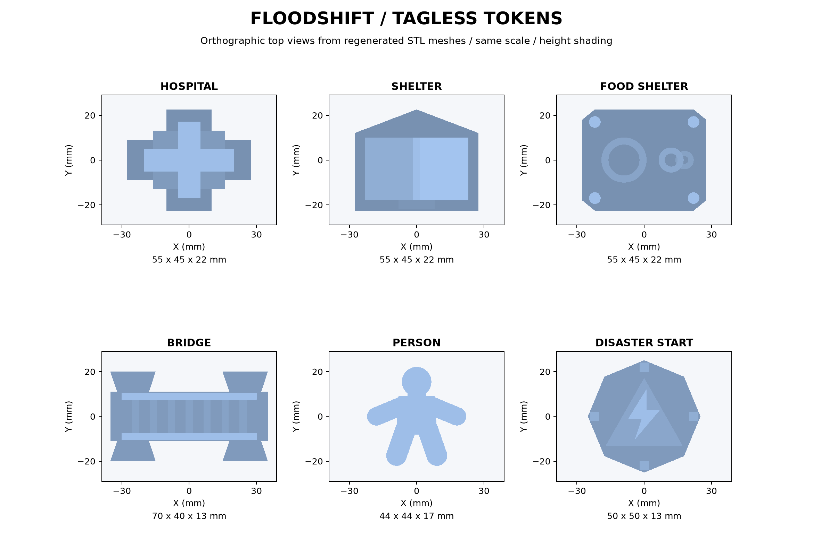

# FLOODSHIFT Person 1 tagless token models

Six OpenSCAD sources and regenerated STL meshes for shape-based Perceptron classification and OpenCV localization/tracking. Each token is one connected printable solid. The former centered 30 x 30 mm token marker pads have been removed; the center now carries the token's recognition geometry. No token stickers, instance IDs, or physical token manifest are supplied. This asset update does not change Person 3's tracking implementation.

Map corner and projector/camera calibration markers remain separate and unchanged.

## Sizes and overhead cues

These are the original asset envelope limits from the previous README/source headers. V2 section 09 gives approximate base widths (around 45-60 mm) and shape requirements, not six exact dimensional envelopes; the existing 70 mm bridge remains the established exception. All revised meshes stay within their original limits.

| Token | Limit X x Y x Z (mm) | Measured STL (mm) | Bird's-eye cue |
|---|---|---|---|
| hospital | 55 x 45 x 22 | 55 x 45 x 22 | Cross-shaped base, low building and large raised roof plus |
| shelter | 55 x 45 x 22 | 55 x 45 x 22 | House-shaped base, solid pitched tent roof and entrance step |
| food_shelter | 55 x 45 x 22 | 55 x 45 x 22 | Four round canopy posts, large bowl rim and smaller handled cup |
| bridge | 70 x 40 x 13 | 70 x 40 x 13 | Long deck, flared approaches, continuous rails and seven slats |
| person | 45 x 45 x 17 | 44 x 44 x 17 | Round head, neck, torso, outstretched arms and splayed legs |
| disaster_start | 50 x 50 x 13 | 50 x 50 x 13 | Octagon, warning triangle, lightning bolt and cardinal rays |



The preview is an orthographic projection of the regenerated meshes, at a common scale with neutral height shading. It is not a photograph or evidence of successful Perceptron classification. STL does not specify filament color. Use shape as the primary cue; V2's optional palette is blue medical, purple shelter, orange food, steel-gray bridge, amber START, and white/green person.

## Printing and geometry checks

Print as exported, with the flat z=0 underside on the bed. Starting settings: 0.4 mm nozzle, 0.16-0.20 mm layers, 3 walls, 15-20% infill; confirm settings with The MILL. All walls rise from a connected base and all downward-facing triangles lie on the bed. No roof or cup handle requires an unsupported bridge. Food station posts are 5 mm in diameter; bowl/cup walls are at least 2.2 mm. The person has 8 mm arms and neck and 9 mm legs, with overlapping roots rather than detached parts. The hospital's former below-bed cross has been corrected.

All six exports passed: one face-connected shell, watertight manifold edge topology, consistent winding, positive solid volume, z-minimum zero, original XYZ envelope limits, and no downward-facing surface above the bed. This establishes mesh integrity and support geometry; slicer review, a trial print, and overhead recognition tests under the actual camera/projector are still needed.

To regenerate with OpenSCAD 2021.01 or later, run for each of the six names:

```powershell
openscad -o hardware/tokens/hospital/hospital.stl hardware/tokens/hospital/hospital.scad
```

To repeat mesh validation and rebuild the preview, install `numpy`, `trimesh`, and `matplotlib` in a local Python environment, then run:

```powershell
python hardware/tokens/validate_preview.py
```

The models intentionally use large geometric symbols rather than small text. Physical class recognition has not been tested against Perceptron. Capture all six alone and together at the final camera height before treating recognition as verified.

## Current tagless tracking interface

The post-merge V2 spec section 07b explicitly adopts markerless tracking. Inspected `backend/perception/pipeline.py` and `backend/perception/tracker.py` for context only: background subtraction proposes object regions, OpenCV CSRT tracks their bounding boxes, Perceptron supplies token classes, and the pipeline emits stable identified placements. Runtime track identifiers belong to Person 3's tracker; this asset pack assigns none. No backend changes or integration claims are made here.

Use matte filament with clear contrast against the pale map, keep the full silhouette visible from above, and space tokens apart so their tracked regions do not merge. At the final camera height, check that the smallest token produces a contour larger than the current tracker's default 1000-pixel minimum area. Initialize the camera on an empty board before placing tokens for motion/background detection. After placement, allow the default 600 ms stability interval and inference time before expecting a confirmed placement. These are setup checks against the current implementation, not proof of runtime recognition. Test neutral light and projector-on conditions with Person 3.

## Remaining V2 conflicts for team review

Section 07b (line 702) states: "This removes the need for ArUco/QR markers on tokens entirely". It separately retains an ArUco fallback at lines 800-812. The following older requirements still read as mandatory or describe a marker-based primary path; the team should reconcile them with section 07b or explicitly label them fallback-only. The shared spec is unchanged.

- Line 123: | **Perceptron semantic piece recognition** | **P0, sponsor centerpiece** | Stable camera frame → Perceptron detects **physical visual class** → bbox; OpenCV fiducial assigns accurate identity/pose | Genuine physical AI interpreting printed miniatures | Recorded **real Perceptron outputs** used in replay, clearly marked replay |
- Line 124: | **OpenCV tracking / calibration** | P0 | Board corners and instance-only fiducials; camera→board mapping; projector manual warp or homography | Immediate response to object movement | Mouse and JSON controls producing identical action schema |
- Line 385: 2. Local CV locates **tokens** using fiducials on their bases, but marker ID **does not encode a token class**. This is important for Perceptron: the vision model must identify the physical object's semantic type.
- Line 439: Hints and icons are **design inputs**, not promised Perceptron predictions. The human team must print visually distinguishable silhouettes and test them. ArUco marker ID encodes **instance identity only**, never `hospital/bridge` semantics. Perceptron classifies the actual printed geometry.
- Line 567: If every 3D piece has a marker that encodes "bridge", "truck", etc., Perceptron becomes unnecessary. **Do not do that.** Use the marker only to derive a stable **instance/pose**. Let **Perceptron** identify the **physical object's visual class** and ground that class to a box in a real image. Then fuse the semantic class and marker pose.
- Line 572: 2. **Register its meaning to an object track** (`fiducial-31`, etc.) via bbox-to-marker association, so moving the piece continues to mean "bridge" even when the cloud inference is idle.
- Line 573: 3. **Re-confirm when the object changes**, e.g. a miniature shelter replaces the bridge on the same base. Cached marker-to-semantic links should expire when the object leaves/re-enters or on operator request.
- Line 613: **Input:** camera frame 1280×720, 4 map corner fiducials, 1–4 movable token markers; physical pieces must have sufficient visual silhouette to be recognized independent of the printed marker.
- Line 617: 1. Stabilization: poll local marker positions at camera framerate. Trigger a semantic inference only when a marker first appears, moves enough to likely represent a new interaction, or its cached label expires.
- Line 621: 5. If a bbox center lies near a known fiducial center (or overlaps its bounding token region), fuse label with marker ID. Prefer one-to-one matching (small Hungarian assignment with SciPy, or greedy nearest match for just 4 objects).
- Line 622: 6. Map the marker's camera pixel center through camera->board homography, not the Perceptron center. This improves precision.
- Line 848: - Token markers, e.g. IDs **30–39**, all identical physical marker dimensions; their IDs are identity ONLY, not semantic type.
- Line 850: - Best practical token design: miniature object sits on an adjacent raised stand/broad base with fiducial visible on its top rim. The marker and the visible object should be within a known offset; if token covers its own tag, tracking collapses.
- Line 851: - Write down **marker ID -> physical piece identity** for QA but **do not encode classification rules** based on the ID in production mode.
- Line 962: **If P1 can only manufacture a few pieces quickly:** priority *bridge → person → food shelter → hospital → sleeping shelter → start*, with the rest initially as cutout/foam proxies **clearly marked as prototypes**. Print all six distinct object tops if throughput permits; attach paper fiducials to generic bases as early tests. The start marker can be a fast printed disc. Any extra trucks/helicopters are optional.
- Line 966: - Start with one standardized *flat matte base* around 45–60 mm width, tailored to actual FOV. More important than exact measurement: at least a 20–30 mm marker visible from the camera at its final mount. Projector light must not wash it out.
- Line 967: - Keep **marker IDs unique per physical instance but semantically neutral**. It must not be possible to determine `food_shelter` vs `hospital` by decoding marker ID; Perceptron should infer it from the physical object and display its box.
- Line 981: // Put 25 mm paper ArUco patch in an unobstructed top corner, outside miniature shadow.
- Line 985: Create six separate `hardware/tokens/<token_type>/` subfolders each containing `source.md`, `model.stl` (when available), `photo_top.jpg`, `photo_oblique.jpg`, `marker_id.txt`, and optional `print_time.txt`. P1 can use a single generic base design while tops differ. A **person** token with a vertical silhouette may be a shaky print; use a chunky person-shaped top on a wide base. The **bridge** should not obstruct the marker when spanning river.
- Line 1776: - If a piece hasn't printed, use a distinct cardboard standee with same instance-only fiducial. Do not cut simulation feature just because filament printing stalled.
- Line 2048: - [ ] Submit six top-down photos or proxy pictures to P3; attach instance-only marker IDs; update `physical_token_manifest.json` and source credits.
- Line 2088: | **v2.0** | Perceptron remains core semantic recognition; marker ID only represents instance/pose | Meaningful sponsored model use | P3 | **Locked design, test model output** |

Related marker-based sample observations (lines 502, 523 and 1889), operator UI references (1472 and 1520), QA/demo assumptions (1646, 1694, 1738 and 1755), and the diagram in section 05 also need team review for the tagless path. The time dial is optional legacy equipment and outside these six assets.

Keep the four static board-corner markers (line 847), calibration corner sheet (line 990), and projector masking of board-corner fiducials (line 1553). Those are map/projector calibration references, not token tags. No token manifest or replacement ID scheme is created. The revised models reserve no flat tag area, so their compatibility with the retained token-tag fallback has not been established.
